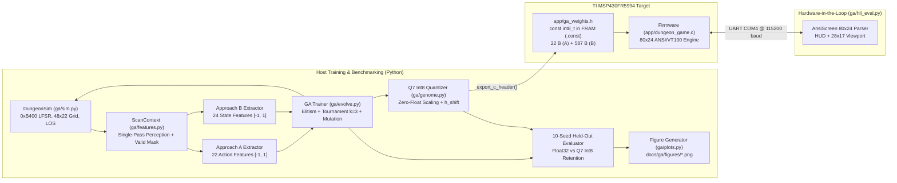

# Genetic Algorithm & Embedded FRAM AI Architecture

This document specifies the end-to-end architecture of the `feat/genetic-algorithm` subsystem in `mspgame`: the bit-faithful headless simulator (`ga/sim.py`), integer-friendly feature extraction (`ga/features.py`), evolutionary optimization (`ga/evolve.py`, `ga/genome.py`), Q7 `int8_t` fixed-point quantization for TI MSP430FR5994 FRAM (`app/ga_weights.h`), and Hardware-in-the-Loop (HIL) UART validation (`ga/hil_eval.py`).

---

## 1. System Architecture Overview



---

## 2. Simulator-to-MSP430 Parity (`ga/sim.py`)

`DungeonSim` in `ga/sim.py` mirrors the Wave-2 firmware game logic in `app/dungeon_game.c` so policies evolved offline transfer directly to the MSP430FR5994 without physics or RNG drift.

### 2.1 Deterministic 16-Bit Galois LFSR

All procedural generation, combat rolls, chest bonuses, and boss telegraphs use the exact 16-bit Galois LFSR polynomial `0xB400`:

```python
lsb = rng & 1
rng >>= 1
if lsb:
    rng ^= 0xB400
rng &= 0xFFFF
```

- Default initial seed: `0x5D17` (zero seeds are remapped to `0x5D17`).
- Verified by `ga/test_sim.py` (`0x5D17 -> 0x9A8B` on the first step).

### 2.2 Grid & Tile Bit Layout

- **Dimensions:** `DNG_W = 48`, `DNG_H = 22` (`1,056` cells, 1 byte per cell on MCU).
- **Low 4 bits (`TILE_TYPE_MASK = 0x0F`):** 13 tile types (`0..12`): `DNG_WALL` (0), `DNG_FLOOR` (1), `DNG_STAIRS` (2), `DNG_DOOR_CLOSED` (3), `DNG_DOOR_OPEN` (4), `DNG_CRACKED_WALL` (5), `DNG_TRAP` (6), `DNG_SHRINE` (7), `DNG_POTION` (8), `DNG_MANA` (9), `DNG_CHEST` (10), `DNG_SHOP` (11), `DNG_RELIC` (12).
- **High 4 bits (flags):** `TILE_F_EXPLORED = 0x10`, `TILE_F_VISIBLE = 0x20`, `TILE_F_REVEALED = 0x40`, `TILE_F_ALT = 0x80`.
- **LOS blockers:** `DNG_WALL`, `DNG_CRACKED_WALL`, `DNG_DOOR_CLOSED`.
- **Movement blockers:** `DNG_WALL`, `DNG_CRACKED_WALL`, `DNG_DOOR_CLOSED`, `DNG_SHOP`.

### 2.3 Floor Biomes & Generation

| Biome | Floor Condition | Generation Algorithm |
| :--- | :--- | :--- |
| **Stone Crypt** | Default (`not boss` and `((fl - 1) & 0x02) == 0`) | Up to 8 non-overlapping rooms (`w in [5, 9]`, `h in [4, 6]`, 45 placement attempts; fallback 2 rooms), L-shaped corridors (+2 loop corridors when `nrooms >= 4`), stairs in farthest room center, up to 6 closed doors (`(rand & 0x07) == 0` at 1-tile chokepoints). |
| **Fungal Caverns** | `not boss` and `((fl - 1) & 0x02) != 0` | Starts at `(24, 11)` with a `3x3` room, runs a 420-step bounded random walk (`2 <= x <= 45`, `2 <= y <= 19`), places stairs at maximum Manhattan distance from spawn. |
| **Boss Sanctum** | `fl > 0 and (fl % 5) == 0` | Fixed layout: entry room `(4, 7, 8x8)`, sanctum `(18, 3, 24x16)`, corridor with closed door at `(14, 11)`, 4 pillar pairs, potion at `(6, 8)`, mana at `(6, 13)`, player at `(7, 11)`, Bone Warden boss at `(32, 11)`. Defeating the boss spawns stairs at `(38, 11)` and two relics at `(30, 9)` and `(30, 13)`. |

Non-boss floors additionally populate: 1 secret alcove behind a `DNG_CRACKED_WALL` (2 alcoves on `floor >= 2`), 1 shrine (Blood Shrine on odd floors, Healing/Def Shrine with `TILE_F_ALT` on even floors), a 3-slot shop (`DNG_MAX_SHOP_ITEMS = 3`) on even floors, 4 traps, 6 pickups (2 potions, 2 mana, 2 chests), and `min(14, 6 + floor)` enemies (up to `DNG_MAX_ENEMIES = 20`).

### 2.4 Integer Bresenham Line-of-Sight (LOS)

- Clears `TILE_F_VISIBLE` across the `48x22` grid, marks the player tile visible & explored, and casts integer Bresenham rays to every cell on the square perimeter of radius `rad`:
  - `rad = LOS_RADIUS = 6` for Knight and Arcanist.
  - `rad = LOS_RADIUS + 1 = 7` for Rogue.
- Any `DNG_TRAP` hit along a ray within Manhattan distance `spot_r` (`4` for Rogue, `2` otherwise) sets `TILE_F_REVEALED`.

### 2.5 Playable Classes, Enemies & Action Space

**Classes (`DungeonSim.reset`):**

| Class | ID | HP | MP | ATK | DEF | Potions | Bombs | Scrolls | Starting Gold | Class Passive |
| :--- | :---: | :---: | :---: | :---: | :---: | :---: | :---: | :---: | :---: | :--- |
| Knight | `0` | 16 | 4 | 3 | 1 | 1 | 0 | 0 | 0 | High survivability & armor |
| Arcanist | `1` | 11 | 8 | 2 | 0 | 1 | 1 | 0 | 0 | Arcane Bolt pierces up to `2` enemies |
| Rogue | `2` | 12 | 5 | 2 | 0 | 1 | 1 | 1 | 25 | `+1` LOS radius, trap spot radius `4`, `+2` melee damage vs full-HP targets |

**Enemy Archetypes (`ENEMY_DEFS`):**

| Enemy | Type ID | Base HP | Damage | Gold (Melee) | Gold (Bolt) | HP Scaling |
| :--- | :---: | :---: | :---: | :---: | :---: | :--- |
| Slime | `1` | 3 | 1 | 6 | 8 | `+(floor - 2) // 2` for `floor >= 4` |
| Skeleton | `2` | 5 | 2 | 12 | 15 | `+(floor - 2) // 2` for `floor >= 4` |
| Archer | `3` | 4 | 2 | 14 | 16 | `+(floor - 2) // 2` for `floor >= 4` |
| Wraith | `4` | 3 | 1 | 16 | 18 | `+(floor - 2) // 2` for `floor >= 4` |
| Mimic | `5` | 6 | 3 | 30 | 30 | `+(floor - 2) // 2` for `floor >= 4` |
| Bone Warden | `6` | 24 | 3 | 100 | 100 | `+((floor - 5) // 5) * 6` for `floor > 5` |

**Discrete Action Space (`NUM_ACTIONS = 11`):**

| Index | Key | Action | Cost / Precondition |
| :---: | :---: | :--- | :--- |
| `0` | `'w'` | Move / Melee / Interact North | Non-wall (affordable if shop) |
| `1` | `'d'` | Move / Melee / Interact East | Non-wall (affordable if shop) |
| `2` | `'s'` | Move / Melee / Interact South | Non-wall (affordable if shop) |
| `3` | `'a'` | Move / Melee / Interact West | Non-wall (affordable if shop) |
| `4` | `'f'` | Cast Arcane Bolt (8-tile ray, breaks cracked walls) | `MP >= 1` |
| `5` | `'q'` | Cast Frost Nova (`3x3` AoE + 2-turn freeze) | `MP >= 2` |
| `6` | `'e'` | Cast Blink (up to 3 tiles in facing direction) | `MP >= 2` and valid destination |
| `7` | `'1'` | Drink Potion (`+6` HP) | `potions > 0` and `hp < max_hp` |
| `8` | `'2'` | Detonate Bomb (`3x3` AoE, destroys walls/cracked walls) | `bombs > 0` |
| `9` | `'3'` | Read Scroll of Mapping (reveals entire floor + traps) | `scrolls > 0` |
| `10` | `' '` | Focus / Wait (`+1` MP, sets `empowered = True`) | Always valid (fallback action) |

---

## 3. Observability Modes & Single-Pass Perception (`ga/features.py`)

Both approaches share a single-pass `precompute_context(sim, omniscient)` routine designed for zero-allocation, integer-friendly execution on MSP430 (no BFS/A*, only grid scans, cardinal neighbor checks, raycasts up to `RAYCAST_MAX_DIST = 6`, and Manhattan distances).

### 3.1 Fair Fog-of-War vs Omniscient

| Aspect | Fair Fog-of-War (`--obs fair`, `omniscient=False`) | Omniscient (`--obs omniscient`, `omniscient=True`) |
| :--- | :--- | :--- |
| **Grid Tiles** | Only cells with `TILE_F_EXPLORED` are scanned. | Entire `48x22` grid is visible. |
| **Enemies** | Only enemies on `TILE_F_VISIBLE` cells are perceived. | All living enemies are perceived. |
| **Dormant Mimics** | Mimics with `(flags & EF_AWAKE) == 0` are hidden from `enemy_pos_map` and tracked in `dormant_mimic_pos` (perceived as loot/chests). | Perceived directly as enemies. |
| **Unrevealed Traps** | `DNG_TRAP` without `TILE_F_REVEALED` is perceived as `DNG_FLOOR`. | All traps are perceived as `DNG_TRAP`. |
| **Exploration Frontier** | `nearest_frontier` = closest explored walkable tile (`!= WALL, CRACKED_WALL, SHOP`) orthogonally adjacent to an unexplored cell. | Unused (`None`). |

### 3.2 Action Masking (`valid_action_mask`)

Before scoring, `valid_action_mask()` produces an 11-boolean tuple masking out wasted actions:
- Directions `0..3`: valid iff in bounds and not `DNG_WALL` / `DNG_CRACKED_WALL` (and affordable/not-full if `DNG_SHOP`).
- `'f'` (4): `mp >= 1`; `'q'` (5): `mp >= 2`; `'e'` (6): `mp >= 2` and `_blink_destination(sim)` exists.
- `'1'` (7): `potions > 0 and hp < max_hp`; `'2'` (8): `bombs > 0`; `'3'` (9): `scrolls > 0`.
- `' '` (10): always `True`.

---

## 4. Feature Definitions (`ga/features.py`)

All features in both approaches are bounded in `[-1, 1]` to map cleanly to Q7 `int8_t` (`[-127, 127]`).

### 4.1 Approach A: Action-Conditioned Heuristic Features (`NUM_HEURISTIC_FEATURES = 22`)

For each valid candidate action `a in 0..10`, `extract_action_features(sim, a, omniscient, ctx)` computes a 22-element vector `phi(s, a)`:

| Idx | Feature Name | Active Actions | Exact Definition |
| :---: | :--- | :---: | :--- |
| `0` | `move_is_melee` | `0..3` | `1.0` if target tile `(nx, ny)` contains a perceived enemy, else `0.0`. |
| `1` | `move_melee_kill` | `0..3` | `1.0` if melee attack on `(nx, ny)` kills the enemy (`enemy.hp <= dmg`, accounting for `empowered` and Rogue `+2` full-HP bonus), else `0.0`. |
| `2` | `move_into_stairs` | `0..3` | `1.0` if `(nx, ny)` is `DNG_STAIRS` (and no enemy), else `0.0`. |
| `3` | `move_into_loot` | `0..3` | `1.0` if `(nx, ny)` is `POTION`, `MANA`, `CHEST`, `RELIC`, a dormant mimic (in fair mode), or a usable `SHRINE`, else `0.0`. |
| `4` | `move_into_shop_buy` | `0..3` | `1.0` if `(nx, ny)` is an affordable, non-full `DNG_SHOP`, else `0.0`. |
| `5` | `move_into_door` | `0..3` | `1.0` if `(nx, ny)` is `DNG_DOOR_CLOSED`, else `0.0`. |
| `6` | `move_into_trap` | `0..3` | `1.0` if perceived tile at `(nx, ny)` is `DNG_TRAP`, else `0.0`. |
| `7` | `move_toward_stairs` | `0..3` | Manhattan step delta (`+1` closer, `-1` farther, `0` unchanged/none) toward `stairs_pos` (non-blocking tiles only). |
| `8` | `move_toward_loot` | `0..3` | Manhattan step delta toward `nearest_loot`. |
| `9` | `move_toward_frontier` | `0..3` | Manhattan step delta toward `nearest_frontier`. |
| `10` | `move_toward_enemy` | `0..3` | Manhattan step delta toward `nearest_enemy`. |
| `11` | `move_unvisited_bonus` | `0..3` | Based on visit count `vc` of `(nx, ny)`: `1.0` if `vc == 0`, `0.0` if `vc == 1`, else `max(-1.0, -0.25 * (vc - 1))`. |
| `12` | `move_danger_delta` | `0..3` | `clip((danger(px, py) - danger(nx, ny)) * 0.5, -1, 1)`, where `danger = (# orthogonally adjacent enemies) + 1.5 * in_aim_line + 1.0 * is_perceived_trap`. |
| `13` | `move_align_bolt` | `0..3` | `1.0` if `mp >= 1` and a raycast in direction `a` up to `6` tiles hits a perceived enemy. |
| `14` | `bolt_hits_enemy` | `4` (`f`) | `1.0` if `mp >= 1` and an 8-tile ray in facing direction `sim.dir` hits a perceived enemy or `DNG_CRACKED_WALL`. |
| `15` | `nova_adj_enemies` | `5` (`q`) | `min(1.0, adj_3x3_enemies / 3.0)` when `mp >= 2` and `adj_3x3_enemies > 0`. |
| `16` | `blink_tactical` | `6` (`e`) | `1.0` if `mp >= 2`, valid blink destination `(bx, by)`, and (`(low_hp and danger_new < danger_now)` or `player_in_aim_line` or `blink moves closer to stairs`). |
| `17` | `potion_urgency` | `7` (`1`) | `min(1.0, (1 - hp / max_hp) * (1.5 if low_hp else 1.0))` when `potions > 0 and hp < max_hp`. |
| `18` | `bomb_value` | `8` (`2`) | `min(1.0, (adj_3x3_enemies + adj_cracked_walls) / 2.0)` when `bombs > 0` and sum `> 0`. |
| `19` | `scroll_value` | `9` (`3`) | `1.0` if `scrolls > 0` and (`stairs_pos is None` or `floor_explored < 120`). |
| `20` | `focus_value` | `10` (`' '`) | `1.0` if `not empowered`, `mp < max_mp`, `adj_3x3_enemies == 0`, and `not player_in_aim_line`. |
| `21` | `low_hp_escape` | `0..3, 6, 7` | `1.0` when `low_hp` (`hp <= 3` or `4*hp <= max_hp`) and action moves/blinks farther from `nearest_enemy`, or drinks a potion (`7`). |

### 4.2 Approach B: State Observation Vector (`NUM_STATE_FEATURES = 24`)

Once per turn, `extract_state_vector(sim, omniscient, ctx)` computes a 24-element state vector `x in [-1, 1]^24`:

| Idx | Feature Name | Exact Definition |
| :---: | :--- | :--- |
| `0` | `hp_ratio` | `2.0 * (hp / max(1, max_hp)) - 1.0` |
| `1` | `mp_ratio` | `2.0 * (mp / max(1, max_mp)) - 1.0` |
| `2` | `empowered` | `1.0` if `empowered` else `-1.0` |
| `3` | `has_potion` | `min(1.0, potions / 3.0)` |
| `4` | `has_bomb_or_scroll` | `(0.5 if bombs > 0 else 0.0) + (0.5 if scrolls > 0 else 0.0)` |
| `5` | `bolt_target_ahead` | `1.0` if `bolt_hits_ahead` else `-1.0` |
| `6..9` | `dir_{n,e,s,w}_tile` | Immediate cardinal neighbor encoding (`N, E, S, W`): `-1.0` out-of-bounds / wall / cracked wall / unaffordable shop; `-0.5` perceived trap; `1.0` enemy / stairs / loot / dormant mimic / usable shrine / affordable shop; `0.5` unvisited walkable tile (`vc == 0`); `0.0` visited walkable tile (`vc > 0`). |
| `10..13` | `dir_{n,e,s,w}_enemy_ray` | 4-direction enemy raycast up to `RAYCAST_MAX_DIST = 6`: `(7 - dist) / 6.0` if hit at `dist in 1..6`, else `0.0`. |
| `14..15` | `stairs_dx`, `stairs_dy` | `clip((stairs_x - px) / 12.0, -1, 1)`, `clip((stairs_y - py) / 12.0, -1, 1)` (`0.0` if unknown). |
| `16..17` | `frontier_dx`, `frontier_dy` | `clip((frontier_x - px) / 12.0, -1, 1)`, `clip((frontier_y - py) / 12.0, -1, 1)` (`0.0` if none). |
| `18..19` | `loot_dx`, `loot_dy` | `clip((loot_x - px) / 12.0, -1, 1)`, `clip((loot_y - py) / 12.0, -1, 1)` (`0.0` if none). |
| `20..21` | `enemy_dx`, `enemy_dy` | `clip((enemy_x - px) / 8.0, -1, 1)`, `clip((enemy_y - py) / 8.0, -1, 1)` (`0.0` if none). |
| `22` | `adj_enemies_3x3` | `min(1.0, adj_3x3_enemies / 3.0)` |
| `23` | `in_danger_or_boss` | `1.0` if `player_in_aim_line` or (`is_low_hp()` and `adj_3x3_enemies > 0`), else `0.5` if `boss_alive`, else `0.0`. |

---

## 5. Genome Topologies (`ga/genome.py`)

| Property | Approach A (`HeuristicGenome`) | Approach B (`TinyMLPGenome`) |
| :--- | :--- | :--- |
| **Architecture** | Linear action scorer `w in R^22` | Fixed-topology MLP `24 -> 16 -> 11` with ReLU hidden layer |
| **Parameter Count** | `22` | `24*16 + 16 + 16*11 + 11 = 587` |
| **Initialization** | `w ~ N(0, 1.0)` | He init `W1 ~ N(0, sqrt(2/24))`, Xavier `W2 ~ N(0, sqrt(1/16))`, `b1, b2 ~ N(0, 0.1)` |
| **Inference** | `argmax_{a in valid_mask} (w · phi(s, a))` | `h = ReLU(W1 x + b1)`, `logits = W2 h + b2`, `argmax_{a in valid_mask} logits[a]` |
| **Fallback Action** | `' '` (index `10`) | `' '` (index `10`) |
| **Weight Clipping** | `[-8.0, 8.0]` | `[-6.0, 6.0]` |
| **FRAM Footprint (Q7)** | **22 bytes** | **587 bytes** |

---

## 6. Multi-Objective Fitness & Evaluation Protocol

### 6.1 Episode Fitness Equation (`DungeonSim.fitness()`)

At the end of an episode (terminated on `sim.game_over`, `turns == max_turns` (default `350`), or `floor_turns >= stall_turns` (default `140`)), fitness is computed as:

$$F = 500 \cdot (\text{best\_floor} - 1) + 2 \cdot \text{total\_explored} + 15 \cdot \text{kills} + 1 \cdot \text{gold} + 60 \cdot \text{shops\_bought} + 1500 \cdot \text{boss\_kills} - 0.5 \cdot \text{wall\_bumps}$$

### 6.2 Train / Held-Out Seed Split (`ga/evolve.py`)

- **Training fitness:** Mean episode fitness (`mean_fit`) across `seeds_n` deterministic 16-bit seeds generated by `generate_train_seeds(ga_seed, seeds_n)` using `np.random.default_rng(ga_seed + 10007)`, guaranteed disjoint from `HELD_OUT_SEEDS`.
- **Held-out benchmark:** Post-training, the overall champion genome is evaluated in both **Float32** and **Q7 Int8** on 10 fixed unseen 16-bit seeds:
  `0x1357, 0x2468, 0x3579, 0x468A, 0x579B, 0x68AC, 0x79BD, 0x8ACE, 0x9BDF, 0xACE1`.
- **Quantization retention:** `held_out_int8["mean_fit"] / held_out_float["mean_fit"]`.

---

## 7. Genetic Algorithm Operators (`ga/evolve.py` & `ga/genome.py`)

| Operator | Configuration |
| :--- | :--- |
| **Elitism** | Top `2` individuals preserved unchanged when `pop <= 32`; top `4` when `pop > 32`. |
| **Selection** | Tournament selection with `k = 3` (sampled without replacement). |
| **Crossover Probability** | `p_cross = 0.80` (otherwise parent `p1` is cloned before mutation). |
| **Crossover (Approach A)** | Per-gene mix: with `p = 0.5`, blend `alpha * w1 + (1 - alpha) * w2` (`alpha ~ U(0, 1)`) else `w1`; then with `p = 0.5`, keep result else take `w2`. |
| **Crossover (Approach B)** | Flattened 587-vector uniform pick (`p = 0.5` from `p1` vs `p2`), overridden with `p = 0.25` by arithmetic blend `alpha * f1 + (1 - alpha) * f2` (`alpha ~ U(0.2, 0.8)`). |
| **Mutation Schedule** | Linear decay over generations `g in [1, G]`: `sigma(g) = sigma_start + (sigma_end - sigma_start) * (g - 1) / max(1, G - 1)`. |
| **Mutation (Approach A)** | `rate = 0.25` per gene, Gaussian noise `sigma: 0.45 -> 0.10`, clipped to `[-8.0, 8.0]`. |
| **Mutation (Approach B)** | `rate = 0.08` per gene, Gaussian noise `sigma: 0.35 -> 0.08`, clipped to `[-6.0, 6.0]`. |
| **Parallelism** | Multiprocessing worker pool (`multiprocessing.Pool`, top-level picklable `_eval_genome_task`). |

---

## 8. Q7 `int8_t` Fixed-Point Quantization for MSP430FR5994 FRAM

The TI MSP430FR5994 is a 16-bit ultra-low-power MCU with **256 KB FRAM**, **8 KB SRAM**, a 32-bit hardware multiplier (`MPY32`), and **no hardware FPU**. Both models are quantized to signed 8-bit Q7 fixed-point (`int8_t` in `[-127, 127]`) with 32-bit integer accumulators (`int32_t`).

### 8.1 Feature Quantization

Every normalized input/action feature `x in [-1, 1]` is quantized via:

$$q_x = \operatorname{clip}\!\left(\operatorname{rint}(127 \cdot x),\,-127,\,127\right) \in \mathbb{Z}_{[-127, 127]}$$

### 8.2 Approach A Quantization (`QuantizedHeuristic`)

1. Compute symmetric max-abs scale: `scale = max(|w|) / 127.0` (fallback `1.0` if `max(|w|) <= 1e-8`).
2. Quantize weights: `q_w = clip(rint(w / scale), -127, 127)` as `int8_t[22]`.
3. Integer-only inference for each valid action `a`:
   $$\text{score}(a) = \sum_{i=0}^{21} \text{int32}(q_{w,i}) \cdot \text{int32}(q_{\phi,i}(s, a))$$
   Because `scale > 0` is constant across all actions, `argmax` is invariant to de-quantization.

### 8.3 Approach B Quantization (`QuantizedTinyMLP`)

1. **Layer 1 scaling:**
   - `scale1 = max(max(|W1|), max(|b1|)) / 127.0`
   - `q_w1 = clip(rint(W1 / scale1), -127, 127)` (`int8_t[16][24]`)
   - `q_b1 = clip(rint(b1 / scale1), -127, 127)` (`int8_t[16]`)
2. **Dynamic power-of-2 hidden right-shift (`h_shift in [7, 11]`):**
   - Computes worst-case per-row L1 accumulator bound `row_l1[i] = sum_j |q_w1[i, j]| * 127 + |q_b1[i]| * 128`.
   - Sets `typical_peak = max(127.0, 0.35 * max_i(row_l1[i]))`.
   - Increments `h_shift` from `7` up to `11` until `typical_peak / 2^h_shift <= 127.0`.
3. **Layer 2 scaling (aligned to hidden activation scale `s_h = (2^h_shift * scale1) / 127.0`):**
   - `scale2 = max(max(|W2|), max(|b2|) / (128.0 * s_h)) / 127.0`
   - `q_w2 = clip(rint(W2 / scale2), -127, 127)` (`int8_t[11][16]`)
   - `q_b2 = clip(rint(b2 / (scale2 * s_h * 128.0)), -127, 127)` (`int8_t[11]`)
4. **Integer-only forward pass:**
   $$\text{acc}_1 = (q_{b1} \ll 7) + q_{W1} \, q_x \quad (\text{int32\_t}[16])$$
   $$q_h = \operatorname{clip}\!\left(\max(0, \text{acc}_1) \gg \text{h\_shift},\,0,\,127\right) \quad (\text{int32\_t}[16])$$
   $$\text{acc}_2 = (q_{b2} \ll 7) + q_{W2} \, q_h \quad (\text{int32\_t}[11])$$
   Select `argmax_{a in valid_mask} acc2[a]`.

### 8.4 FRAM C Header Export (`app/ga_weights.h`)

`export_c_header(heuristic_genome, mlp_genome, out_path)` emits `static const int8_t` arrays that the TI MSP430 compiler places automatically into FRAM (`.const`), consuming **0 bytes of SRAM** for weights:

- `GA_HEUR_WEIGHTS[22]`: **22 bytes**
- `GA_MLP_W1[16][24]` (384 B) + `GA_MLP_B1[16]` (16 B) + `GA_MLP_W2[11][16]` (176 B) + `GA_MLP_B2[11]` (11 B): **587 bytes**
- **Combined weight footprint:** **609 bytes** of 256 KB FRAM (`0.23%`), plus `GA_MLP_H_SHIFT` macro.
