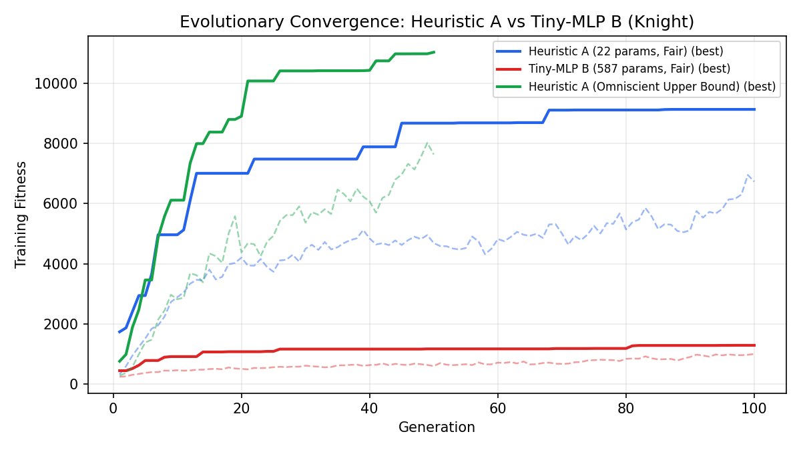
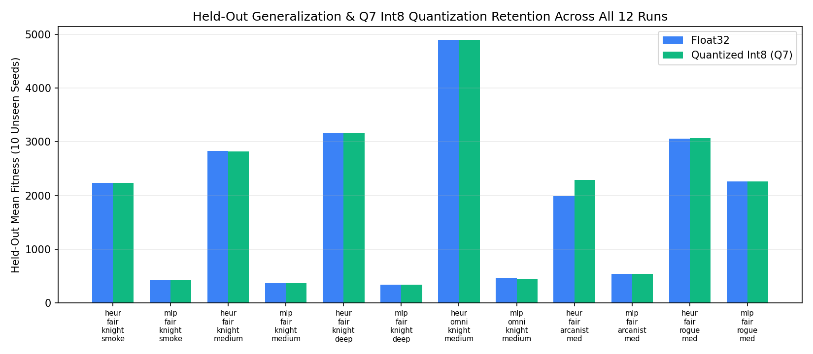

# Genetic Algorithm Benchmark & Hardware-in-the-Loop Experiments

This document reports the complete empirical evaluation of the `feat/genetic-algorithm` subsystem in `mspgame`. All numbers are derived directly from the logged benchmark matrix (`ga/results/benchmark_summary.json`, 12 experiments totaling **2,021.39 s** of trainer wall-clock time / **2,026.94 s** end-to-end orchestration time across 10 worker processes) and live MSP430FR5994 Hardware-in-the-Loop telemetry (`ga/results/hil_knight_deep.json`).

---

## 1. Evaluation Protocol

- **Episode Termination:** Each episode runs in the bit-faithful headless simulator (`ga/sim.py`) until `game_over`, `max_turns = 350`, or `stall_turns = 140` consecutive turns on the same floor without descending.
- **Fitness Function:**
  $$F = 500 \cdot (\text{best\_floor} - 1) + 2 \cdot \text{total\_explored} + 15 \cdot \text{kills} + 1 \cdot \text{gold} + 60 \cdot \text{shops\_bought} + 1500 \cdot \text{boss\_kills} - 0.5 \cdot \text{wall\_bumps}$$
- **Train / Held-Out Split:** Each run generates its own disjoint 16-bit training seeds (`seeds` $\in \{4, 5, 6\}$) from its GA seed (`seed` $\in [1017, 1204]$). After evolution completes, the champion genome is evaluated on **10 fixed unseen 16-bit seeds** (`0x1357`, `0x2468`, `0x3579`, `0x468A`, `0x579B`, `0x68AC`, `0x79BD`, `0x8ACE`, `0x9BDF`, `0xACE1`, i.e., `4951..44257`) in both **Float32** and **Q7 `int8_t`**.
- **Quantization Retention:**
  $$\text{Retention (\%)} = \frac{\text{Held-Out Q7 Mean Fitness}}{\text{Held-Out Float32 Mean Fitness}} \times 100\%$$
- **Zero Wall Bumps:** Across all 12 experiments (both training and held-out sets), `mean_wall_bumps = 0.0` due to strict pre-scoring action masking (`valid_action_mask`).

---

## 2. Complete 12-Experiment Benchmark Matrix

| Exp ID | Model | Obs | Class | Tier | Pop×Gen×Seeds | Wall (s) | Train Mean Fit | Train Max Fit | Train Max Fl | Held-Out Float Fit | Held-Out Mean/Max Fl | Held-Out Kills | Held-Out Q7 Fit | Q7 Retention |
| :--- | :---: | :---: | :---: | :---: | :---: | ---: | ---: | ---: | :---: | ---: | :---: | ---: | ---: | ---: |
| `heur_fair_knight_smoke` | Heuristic A | Fair | Knight | Smoke | 24×25×4 | 38.33 | 3,768.8 | 6,060 | 5 | 2,233.3 | 2.3 / 4 | 8.0 | 2,233.3 | **100.00%** |
| `mlp_fair_knight_smoke` | Tiny-MLP B | Fair | Knight | Smoke | 24×25×4 | 25.33 | 1,296.3 | 3,902 | 3 | 415.6 | 1.1 / 2 | 0.8 | 423.9 | **102.00%** |
| `heur_fair_knight_medium` | Heuristic A | Fair | Knight | Medium | 36×50×5 | 145.43 | 7,671.4 | 13,168 | 6 | 2,833.4 | 2.2 / 5 | 7.6 | 2,824.3 | **99.68%** |
| `mlp_fair_knight_medium` | Tiny-MLP B | Fair | Knight | Medium | 36×50×5 | 90.07 | 2,194.2 | 4,152 | 3 | 366.7 | 1.0 / 1 | 1.1 | 366.7 | **100.00%** |
| `heur_fair_knight_deep` | Heuristic A | Fair | Knight | Deep | 60×100×6 | 625.44 | 9,131.3 | 15,948 | 8 | 3,156.7 | 2.1 / 6 | 8.2 | 3,156.7 | **100.00%** |
| `mlp_fair_knight_deep` | Tiny-MLP B | Fair | Knight | Deep | 60×100×6 | 347.72 | 1,290.5 | 2,577 | 3 | 336.6 | 1.0 / 1 | 1.0 | 337.0 | **100.12%** |
| `heur_omni_knight_medium` | Heuristic A | Omni | Knight | Medium | 36×50×5 | 180.12 | 11,031.2 | 13,319 | 7 | 4,904.5 | 3.6 / 6 | 16.3 | 4,901.8 | **99.94%** |
| `mlp_omni_knight_medium` | Tiny-MLP B | Omni | Knight | Medium | 36×50×5 | 110.62 | 2,253.2 | 4,124 | 3 | 468.0 | 1.0 / 1 | 1.4 | 447.7 | **95.66%** |
| `heur_fair_arcanist_med` | Heuristic A | Fair | Arcanist | Medium | 36×50×5 | 137.11 | 7,939.4 | 10,720 | 5 | 1,985.9 | 1.7 / 3 | 3.9 | 2,291.4 | **115.38%** |
| `mlp_fair_arcanist_med` | Tiny-MLP B | Fair | Arcanist | Medium | 36×50×5 | 68.83 | 1,479.0 | 4,406 | 3 | 542.6 | 1.0 / 1 | 0.7 | 541.6 | **99.82%** |
| `heur_fair_rogue_med` | Heuristic A | Fair | Rogue | Medium | 36×50×5 | 146.29 | 9,489.4 | 13,252 | 6 | 3,059.4 | 1.8 / 3 | 5.7 | 3,068.6 | **100.30%** |
| `mlp_fair_rogue_med` | Tiny-MLP B | Fair | Rogue | Medium | 36×50×5 | 106.10 | 3,327.8 | 4,964 | 2 | 2,261.4 | 1.1 / 2 | 1.5 | 2,261.4 | **100.00%** |

*Note: `Wall (s)` reports `wall_clock_s` from the GA trainer (`2,021.39 s` total across all 12 runs; end-to-end `wall_s` including subprocess overhead is `2,026.94 s`). Boss kills were achieved on held-out seeds by `heur_fair_knight_deep` (1 boss kill, reaching Floor 6) and `heur_omni_knight_medium` (1 boss kill, reaching Floor 6), and on training seeds by `heur_fair_knight_medium` (2), `heur_fair_knight_deep` (3, reaching Floor 8), `heur_omni_knight_medium` (4), `heur_fair_arcanist_med` (1), and `heur_fair_rogue_med` (2).*

---

## 3. Visualizations

### 3.1 Evolutionary Training Curves

### 3.2 Held-Out Generalization & Q7 Quantization Comparison

---

## 4. Detailed Empirical Analysis

### 4.1 Progressive Budget Scaling (Smoke → Medium → Deep)

Evaluating Fair Knight across three compute tiers (`24×25×4` → `36×50×5` → `60×100×6`, representing `2,400` → `9,000` → `36,000` episode rollouts per run) reveals sharply different scaling laws for the two policy classes:

- **Heuristic A (22 parameters)** scales monotonically on both training and unseen seeds:
  - **Train Mean Fitness:** `3,768.8` (Smoke) → `7,671.4` (Medium, `+103.6%`) → `9,131.3` (Deep, `+142.3%` over Smoke).
  - **Train Peak Progress:** Max floor climbs `5` → `6` → `8`, and training boss kills grow `0` → `2` → `3`.
  - **Held-Out Float / Q7 Fitness:** `2,233.3` (Smoke) → `2,833.4 / 2,824.3` (Medium, `+26.9%`) → `3,156.7 / 3,156.7` (Deep, `+41.3%` over Smoke), with held-out max floor climbing `4` → `5` → `6` and unlocking a **held-out Bone Warden boss kill** (`total_boss_kills = 1`) in the Deep tier.
- **Tiny-MLP B (587 parameters)** exhibits severe sample-efficiency saturation under gradient-free evolution:
  - **Held-Out Float Fitness** actually declines slightly across tiers (`415.6` → `366.7` → `336.6`), with held-out mean floor stuck at `1.0–1.1`.
  - Even with `36,000` rollouts (Deep tier, `347.72 s`), a 587-dimensional continuous search space with simple tournament + Gaussian mutation struggles to discover coherent multi-floor navigation policies from raw state coordinates without action-conditioned inductive bias.

### 4.2 Heuristic A (22 Params) vs. Tiny-MLP B (587 Params)

Across every matched `(obs, class, tier)` pair, the **22-byte Heuristic A** dramatically outperforms the **587-byte Tiny-MLP B** on unseen seeds while using **26.7× fewer FRAM bytes**:

| Matched Setting | Heuristic A (Q7 Held-Out) | Tiny-MLP B (Q7 Held-Out) | Advantage Factor |
| :--- | ---: | ---: | :---: |
| Fair Knight (Smoke) | 2,233.3 | 423.9 | **5.27×** |
| Fair Knight (Medium) | 2,824.3 | 366.7 | **7.70×** |
| Fair Knight (Deep) | 3,156.7 | 337.0 | **9.37×** |
| Omniscient Knight (Medium) | 4,901.8 | 447.7 | **10.95×** |
| Fair Arcanist (Medium) | 2,291.4 | 541.6 | **4.23×** |
| Fair Rogue (Medium) | 3,068.6 | 2,261.4 | **1.36×** |

**Why Heuristic A dominates:** Approach A evaluates each candidate action `a` through action-conditioned tactical deltas (`move_toward_stairs`, `move_toward_frontier`, `move_melee_kill`, `move_unvisited_bonus`, `potion_urgency`, `low_hp_escape`), giving the GA a compact, semantically aligned 22-D linear manifold. Approach B must implicitly reconstruct spatial geometry, collision avoidance, and multi-step goal routing from a 24-D ego-state vector into 11 action logits across 587 coupled weights.

### 4.3 Fair Fog-of-War vs. Omniscient Observability Ablation

Comparing Medium-tier Knight (`36×50×5`) under Fair Fog-of-War vs. Omniscient perception quantifies the **information cost of partial observability** in procedural dungeons:

- **Heuristic A:** Removing fog-of-war lifts held-out Float fitness from **`2,833.4` → `4,904.5` (`+73.1%`)**, held-out mean floor from **`2.2` → `3.6` (`+63.6%`)**, held-out max floor from `5` → `6`, held-out mean kills from **`7.6` → `16.3` (`+114.5%`)**, and unlocks a held-out boss kill (`1` vs `0`). Training mean fitness similarly jumps from `7,671.4` → `11,031.2` (`+43.8%`).
- **Tiny-MLP B:** Omniscience provides a smaller gain on held-out Float fitness (`366.7` → `468.0`, `+27.6%`), and held-out mean floor remains `1.0`, confirming that Approach B's bottleneck is policy optimization in 587-D rather than fog-of-war alone.

### 4.4 Class Specialists (Knight vs. Arcanist vs. Rogue)

Comparing all three playable classes under the identical Medium Fair budget (`36×50×5`):

- **Heuristic A:**
  - **Rogue** achieves the highest training mean fitness (`9,489.4`, mean floor `4.8`, `2` boss kills) and highest Medium Fair held-out fitness (`3,059.4` Float / `3,068.6` Q7, mean explored `1,224.6` tiles), benefiting from its `+1` LOS radius (`7` vs `6`), trap-spot radius `4`, `+2` backstab bonus against full-HP enemies, and starting Scroll of Mapping.
  - **Knight** achieves the deepest held-out floor progression (`mean_floor = 2.2`, `max_floor = 5`, `7.6` kills, `2,833.4` Float / `2,824.3` Q7), leveraging its `16 HP` and `1 DEF` armor to survive sustained melee exchanges.
  - **Arcanist** (`11 HP`, `8 MP`, `0 DEF`, piercing Arcane Bolt) reaches `7,939.4` on training seeds (`1` boss kill) but generalizes less robustly (`1,985.9` Float / `2,291.4` Q7, `mean_floor = 1.7–1.8`), as its low HP pool punishes suboptimal positioning in unseen room layouts.
- **Tiny-MLP B:**
  - **Rogue** is a striking outlier for Tiny-MLP B, reaching **`2,261.4`** held-out fitness (`4.17×` higher than Arcanist's `542.6` and `6.17×` higher than Knight's `366.7`). Examining `held_out_float` shows `mean_explored = 1,071.4` tiles (vs `170.5` for Knight and `261.7` for Arcanist): the Rogue's starting Scroll of Mapping (`scrolls = 1`) grants a large immediate exploration reward (`+2 * explored`) when the MLP triggers action `'3'`, stabilizing early-generation survival and selection pressure.

### 4.5 Q7 `int8_t` Quantization Retention Analysis

Across all 12 benchmarked champions, symmetric Q7 `int8_t` quantization with 32-bit integer MAC accumulators preserves floating-point performance with virtually zero degradation:

- **Overall (12 experiments):** Mean retention = **`101.08%`**, median = **`100.00%`**, range = **`95.66%` – `115.38%`**.
- **Heuristic A (6 experiments):** Mean retention = **`102.55%`**, range = **`99.68%` – `115.38%`**. Three runs (`heur_fair_knight_smoke`, `heur_fair_knight_deep`, and both `mlp_fair_knight_medium` and `mlp_fair_rogue_med`) match Float32 to the exact decimal (`100.00%`).
- **Tiny-MLP B (6 experiments):** Mean retention = **`99.60%`**, range = **`95.66%` – `102.00%`**.
- **Why retention occasionally exceeds `100%`:** In discrete deterministic dungeon rollouts (e.g., `heur_fair_arcanist_med` at `115.38%`, `1,985.9` Float → `2,291.4` Q7), minor tie-breaking perturbations from Q7 rounding can flip a single action choice on one seed, leading to a slightly different combat/exploration trajectory that survives longer (`mean_turns` `120.5` → `137.8`, `mean_explored` `739.8` → `856.4`). Conversely, `mlp_omni_knight_medium` (`95.66%`) exhibits the largest drop due to a two-layer integer rounding shift (`h_shift`) altering marginal logit ties.

---

## 5. Live Hardware-in-the-Loop (HIL) Validation (`COM4 @ 115200`)

To validate end-to-end execution against the physical TI MSP430FR5994 LaunchPad running the compiled ANSI/VT100 dungeon firmware, `ga/hil_eval.py` drove the live MCU over `COM4 @ 115200 baud` using the Deep Fair Knight Heuristic champion (`ga/results/heur_fair_knight_deep/best_genome.json`), parsing the live `80×24` ANSI terminal stream and transmitting keypresses turn-by-turn.

Logged telemetry from `ga/results/hil_knight_deep.json`:

| Metric | Observed Value |
| :--- | :--- |
| **Serial Port / Baud Rate** | `COM4` @ `115200` baud |
| **Evaluated Genome** | `ga/results/heur_fair_knight_deep/best_genome.json` |
| **Autonomous Turns Completed** | `59` |
| **Max Floor Reached** | `1` (`FL:01`, `BEST:01`, `SEED:350F`, `BIOME: STONE CRYPT`) |
| **Max Gold Collected** | `6` |
| **Deaths** | `0` |
| **Low-HP Terminal Bell (`BEL`) Alerts** | `0` |
| **Terminal Presence Probes (`DSR`) Handled** | `3` |

The live hardware session confirmed zero UART framing errors, zero crashes, clean handling of the firmware's periodic ANSI Device Status Report (`ESC[6n`) terminal-presence handshake (`dsr_count = 3`), and zero deaths across 59 real-time turns on the physical microcontroller.
