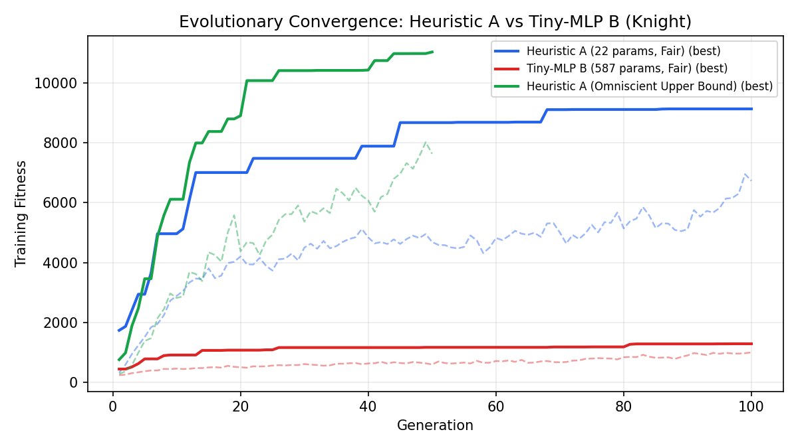
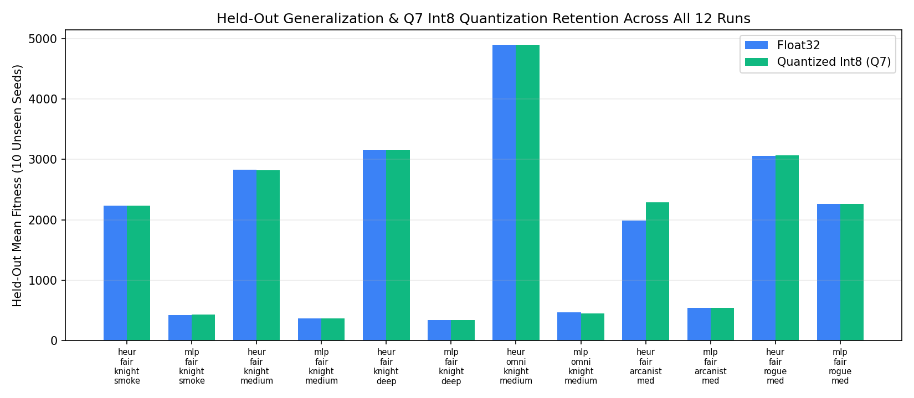

# Evolving Zero-Float Q7 Autonomous Policies for a 16-Bit FRAM Microcontroller Roguelike

**Author:** `joaogpd`

---

## Abstract

Deploying autonomous game-playing agents on ultra-low-power 16-bit microcontrollers without a hardware Floating-Point Unit (FPU) requires compact policy representations, strict memory discipline, and bit-faithful offline-to-hardware transfer. We present a complete end-to-end evolutionary pipeline and on-chip deployment for `mspgame`, a procedural 80×24 ANSI/VT100 roguelike running on the Texas Instruments **MSP430FR5994** (16-bit core, 256 KB FRAM, 8 KB SRAM). We construct a bit-faithful Python headless simulator matching the firmware's 16-bit Galois LFSR (`0xB400`), `48×22` dungeon tile layout, integer Bresenham line-of-sight, and combat rules, and evolve two zero-float Q7 `int8_t` policy architectures: **Approach A**, a 22-parameter action-conditioned linear heuristic (22 bytes in FRAM), and **Approach B**, a 587-parameter fixed-topology Tiny-MLP (`24 → 16 → 11` ReLU, 587 bytes in FRAM). Across a 12-experiment benchmark matrix (`2,021.39 s` total trainer wall-clock time) spanning compute budgets (Smoke, Medium, Deep), observability modes (Fair Fog-of-War vs. Omniscient), and three playable classes (Knight, Arcanist, Rogue), the 22-byte Heuristic A outperforms the 587-byte Tiny-MLP B by **1.36× to 10.95×** on 10 unseen held-out seeds—reaching Floor 6 and defeating the Floor-5 Bone Warden boss under Fair Fog-of-War (`3,156.7` mean held-out fitness)—while symmetric Q7 `int8_t` quantization achieves **`101.08%` mean** (`100.00%` median, `95.66%–115.38%` range) fitness retention relative to Float32. Both models are compiled directly into the MSP430FR5994 firmware (`609` bytes of FRAM weights, `3,668` bytes of inference code, `2,385 / 4,096` bytes total RAM, `45.7 / 262.0 KB` total FRAM, `0` bytes dynamic heap), validated via live Hardware-in-the-Loop UART testing (`COM4 @ 115200 baud`, 55 Heuristic A turns and 34 Tiny-MLP B turns, 0 deaths), and exposed interactively via an on-chip `[4] AI DEMO` mode supporting live Heuristic/MLP toggling.

---

## I. Introduction

Embedded machine learning ("TinyML") predominantly targets 32-bit Arm Cortex-M microcontrollers with DSP/SIMD extensions and tens to hundreds of kilobytes of SRAM. Ultra-low-power 16-bit microcontrollers such as the TI MSP430FR5994 operate under far tighter constraints: no hardware FPU, 4 KB of general-purpose SRAM (`RAM`), and byte-addressed non-volatile Ferroelectric RAM (FRAM). Yet sequential decision-making tasks—such as navigating procedural dungeons with partial observability, resource management, and tactical combat—can still be solved autonomously on-chip if policy design, feature extraction, and fixed-point quantization are co-designed with the hardware.

In this work, we investigate **neuroevolution and heuristic weight evolution** for `mspgame`, an ANSI/VT100 roguelike dungeon crawler written in C for the MSP430FR5994 LaunchPad. Rather than relying on backpropagation or large neural networks, we use a parallel Genetic Algorithm (GA) over a bit-faithful offline simulator and export symmetric Q7 `int8_t` weights directly to FRAM `.const` arrays. Our contributions are:

1. **Bit-Faithful Offline-to-MCU Parity:** A headless Python simulator (`ga/sim.py`) replicating the MSP430 firmware's `0xB400` Galois LFSR, `48×22` grid bitfields, three floor biomes, integer Bresenham LOS, and 11-action combat/item mechanics.
2. **Controlled Architectural & Observability Benchmark:** A reproducible 12-experiment study comparing a 22-parameter action-conditioned Heuristic (Approach A) against a 587-parameter Tiny-MLP (Approach B) across progressive compute tiers, Fair Fog-of-War vs. Omniscient perception, and three playable classes.
3. **Zero-Float Q7 Quantization & On-Chip FRAM Deployment:** A power-of-2 shift Q7 quantization scheme achieving `101.08%` mean retention across all 12 champions, deployed in `609` bytes of FRAM (`0.23%` of device FRAM) with `0` bytes of dynamic heap and validated live over `COM4 @ 115200 baud`.

---

## II. Target Hardware & Game Environment

### A. TI MSP430FR5994 Hardware Platform

The target device is the **Texas Instruments MSP-EXP430FR5994 LaunchPad**, featuring a 16-bit MSP430X CPU, a 32-bit hardware multiplier (`MPY32`), **256 KB FRAM** (`262,008` usable bytes split across `FRAM` and `FRAM2`), **4 KB main SRAM** (`4,096` bytes), **4 KB Low-Energy Accelerator SRAM** (`LEARAM` + `LEASTACK`, `4,096` bytes), and backchannel USB UART (`UART_A0` at `115200` baud). Because software floating-point emulation is costly in both cycles and code size, all on-chip AI inference uses strictly 8-bit signed features/weights (`int8_t`) and 32-bit integer accumulators (`int32_t`).

### B. Procedural Roguelike Environment (`mspgame`)

The game renders an 80×24 ANSI/VT100 interface over UART with a `28×17` scrolling viewport over a `48×22` (`1,056`-cell) dungeon grid (`1` byte/cell: low 4 bits encode 13 tile types `0..12`; high 4 bits encode `EXPLORED`, `VISIBLE`, `REVEALED`, and `ALT` flags). Procedural floors cycle through three biomes:
- **Stone Crypt:** Up to 8 non-overlapping rooms (`w ∈ [5, 9]`, `h ∈ [4, 6]`), L-shaped corridors with loop corridors, and up to 6 closed doors.
- **Fungal Caverns:** A 420-step bounded random walk from `(24, 11)` with stairs placed at maximum Manhattan distance.
- **Boss Sanctum** (`floor % 5 == 0`): A fixed arena housing the **Bone Warden** boss (`24` base HP, `3` DMG, `100` gold), whose defeat spawns exit stairs and two relics.

Players select one of three classes: **Knight** (`16` HP, `4` MP, `3` ATK, `1` DEF), **Arcanist** (`11` HP, `8` MP, `2` ATK, `0` DEF, piercing Arcane Bolt), or **Rogue** (`12` HP, `5` MP, `2` ATK, `0` DEF, `25` gold, `+1` LOS radius `7` vs. `6`, trap spot radius `4` vs. `2`, `+2` melee bonus vs. full-HP enemies, starting Scroll of Mapping). Six enemy archetypes scale with floor depth. Each turn, the agent selects one of **`11` discrete actions**: 4 cardinal moves/melee (`w, d, s, a`), 3 spells (`f` Arcane Bolt, `q` Frost Nova, `e` Blink), 3 items (`1` Potion, `2` Bomb, `3` Scroll of Mapping), or Focus/Wait (`' '`).

---

## III. Methodology

### A. Bit-Faithful Headless Simulator

`ga/sim.py` implements `DungeonSim` with exact parity to `app/dungeon_game.c`, including the 16-bit Galois LFSR (`rng >>= 1; if lsb: rng ^= 0xB400`, default seed `0x5D17 → 0x9A8B`), integer Bresenham raycasting for LOS, and identical combat/shop/trap/boss rules. Episodes terminate upon death (`game_over`), `max_turns = 350`, or `stall_turns = 140` turns on a single floor without descending.

### B. Single-Pass Perception, Observability Modes, and Action Masking

Both policy families share a zero-allocation, single-pass grid scanner (`precompute_context`) suited to MSP430 (no BFS/A*; only Manhattan distances and cardinal raycasts up to 6–8 tiles). We evaluate two observability modes:
- **Fair Fog-of-War (`fair`):** Scans only `TILE_F_EXPLORED` cells and `TILE_F_VISIBLE` enemies; dormant mimics appear as chests, unrevealed traps appear as floor, and the scanner tracks the nearest unexplored walkable frontier.
- **Omniscient (`omniscient`):** Reveals the full `48×22` grid, all living enemies, mimics, and traps (ablation upper bound).

Before scoring, `valid_action_mask()` masks out illegal actions (walls, unaffordable shops, insufficient MP, full-HP potion drinks), guaranteeing `0.0` wall bumps across every episode.

### C. Policy Architectures: Heuristic A vs. Tiny-MLP B

All features are normalized to `[-1, 1]` for clean Q7 mapping:
- **Approach A (`HeuristicGenome`, 22 parameters):** For each valid action $a \in \{0,\dots,10\}$, computes a 22-element action-conditioned tactical feature vector $\phi(s, a) \in [-1, 1]^{22}$ (melee/kill indicators, stairs/loot/shop/door/trap step indicators, Manhattan step deltas toward stairs/loot/frontier/enemy, recent-visit novelty bonus, local danger delta, bolt alignment, spell/item urgency, and low-HP escape). Selects $a^* = \arg\max_{a \in \mathcal{V}(s)} w^\top \phi(s, a)$.
- **Approach B (`TinyMLPGenome`, 587 parameters):** Computes a 24-element ego-state vector $x \in [-1, 1]^{24}$ (HP/MP ratios, empowerment, consumables, bolt target ahead, 4 cardinal neighbor encodings, 4 enemy raycasts, relative `(dx, dy)` vectors to stairs/frontier/loot/enemy, 3×3 adjacent enemy count, danger/boss flag) and evaluates a `24 → 16 → 11` ReLU MLP:
  $$h = \operatorname{ReLU}(W_1 x + b_1), \qquad z = W_2 h + b_2, \qquad a^* = \arg\max_{a \in \mathcal{V}(s)} z_a$$
  Total parameters: $24 \times 16 + 16 + 16 \times 11 + 11 = 587$.

### D. Fitness Function & Evolutionary Operators

Each episode yields a multi-objective scalar fitness:
$$F = 500(\text{best\_floor} - 1) + 2\,\text{total\_explored} + 15\,\text{kills} + \text{gold} + 60\,\text{shops\_bought} + 1500\,\text{boss\_kills} - 0.5\,\text{wall\_bumps}$$

Genomes are scored by mean fitness across `seeds` disjoint 16-bit training seeds using a 10-worker `multiprocessing.Pool`. Evolution uses elitism (`2` elites for `pop <= 32`, `4` for `pop > 32`), tournament selection (`k = 3`), crossover (`p_cross = 0.80`), and linearly decaying Gaussian mutation (`rate = 0.25`, $\sigma: 0.45 \to 0.10$, clip `[-8, 8]` for Approach A; `rate = 0.08`, $\sigma: 0.35 \to 0.08$, clip `[-6, 6]` for Approach B). Post-training, champions are evaluated on **10 fixed unseen 16-bit seeds** (`0x1357` through `0xACE1`) in both Float32 and Q7 `int8_t`.

### E. Symmetric Q7 `int8_t` Quantization

Normalized inputs $x \in [-1, 1]$ map to $q_x = \operatorname{clip}(\operatorname{rint}(127 x), -127, 127)$.
- **Approach A:** Symmetric max-abs scale $s = \max|w|/127$; $q_w = \operatorname{clip}(\operatorname{rint}(w/s), -127, 127)$. Inference computes $\text{score}(a) = \sum_{i=0}^{21} \text{int32}(q_{w,i}) \cdot \text{int32}(q_{\phi,i}(s, a))$; `argmax` is scale-invariant.
- **Approach B:** Layer 1 uses $s_1 = \max(\max|W_1|, \max|b_1|)/127$. A dynamic power-of-2 hidden shift `h_shift` $\in [7, 11]$ is chosen from the worst-case L1 row bound so typical activations fit in `[0, 127]` (`GA_MLP_H_SHIFT = 9` for the exported Deep Fair Knight MLP). Layer 2 aligns $q_{W_2}, q_{b_2}$ to the hidden scale $s_h = 2^{\text{h\_shift}} s_1 / 127$:
  $$\text{acc}_1 = (q_{b_1} \ll 7) + q_{W_1} q_x, \qquad q_h = \operatorname{clip}(\max(0, \text{acc}_1) \gg \text{h\_shift},\, 0,\, 127)$$
  $$\text{acc}_2 = (q_{b_2} \ll 7) + q_{W_2} q_h, \qquad a^* = \arg\max_{a \in \mathcal{V}(s)} \text{acc}_{2,a}$$

---

## IV. Experimental Results

### A. 12-Experiment Benchmark Matrix

Table I summarizes all 12 benchmark runs (`2,021.39 s` total trainer wall-clock time across 10 workers; `mean_wall_bumps = 0.0` across all runs).

| Exp ID | Model | Obs | Class | Tier | Pop×Gen×S | Wall (s) | Train Mean | Train Max | Tr MaxFl | Held-Out F32 | HO Fl (M/Max) | HO Kills | Held-Out Q7 | Q7 Ret. |
| :--- | :---: | :---: | :---: | :---: | :---: | ---: | ---: | ---: | :---: | ---: | :---: | ---: | ---: | ---: |
| `heur_fair_knight_smoke` | Heur A | Fair | Knight | Smoke | 24×25×4 | 38.33 | 3,768.8 | 6,060 | 5 | 2,233.3 | 2.3 / 4 | 8.0 | 2,233.3 | 100.00% |
| `mlp_fair_knight_smoke` | MLP B | Fair | Knight | Smoke | 24×25×4 | 25.33 | 1,296.3 | 3,902 | 3 | 415.6 | 1.1 / 2 | 0.8 | 423.9 | 102.00% |
| `heur_fair_knight_medium` | Heur A | Fair | Knight | Med | 36×50×5 | 145.43 | 7,671.4 | 13,168 | 6 | 2,833.4 | 2.2 / 5 | 7.6 | 2,824.3 | 99.68% |
| `mlp_fair_knight_medium` | MLP B | Fair | Knight | Med | 36×50×5 | 90.07 | 2,194.2 | 4,152 | 3 | 366.7 | 1.0 / 1 | 1.1 | 366.7 | 100.00% |
| `heur_fair_knight_deep` | Heur A | Fair | Knight | Deep | 60×100×6 | 625.44 | 9,131.3 | 15,948 | 8 | 3,156.7 | 2.1 / 6 | 8.2 | 3,156.7 | 100.00% |
| `mlp_fair_knight_deep` | MLP B | Fair | Knight | Deep | 60×100×6 | 347.72 | 1,290.5 | 2,577 | 3 | 336.6 | 1.0 / 1 | 1.0 | 337.0 | 100.12% |
| `heur_omni_knight_medium` | Heur A | Omni | Knight | Med | 36×50×5 | 180.12 | 11,031.2 | 13,319 | 7 | 4,904.5 | 3.6 / 6 | 16.3 | 4,901.8 | 99.94% |
| `mlp_omni_knight_medium` | MLP B | Omni | Knight | Med | 36×50×5 | 110.62 | 2,253.2 | 4,124 | 3 | 468.0 | 1.0 / 1 | 1.4 | 447.7 | 95.66% |
| `heur_fair_arcanist_med` | Heur A | Fair | Arcanist | Med | 36×50×5 | 137.11 | 7,939.4 | 10,720 | 5 | 1,985.9 | 1.7 / 3 | 3.9 | 2,291.4 | 115.38% |
| `mlp_fair_arcanist_med` | MLP B | Fair | Arcanist | Med | 36×50×5 | 68.83 | 1,479.0 | 4,406 | 3 | 542.6 | 1.0 / 1 | 0.7 | 541.6 | 99.82% |
| `heur_fair_rogue_med` | Heur A | Fair | Rogue | Med | 36×50×5 | 146.30 | 9,489.4 | 13,252 | 6 | 3,059.4 | 1.8 / 3 | 5.7 | 3,068.6 | 100.30% |
| `mlp_fair_rogue_med` | MLP B | Fair | Rogue | Med | 36×50×5 | 106.10 | 3,327.8 | 4,964 | 2 | 2,261.4 | 1.1 / 2 | 1.5 | 2,261.4 | 100.00% |

*Fig. 1. Evolutionary training fitness progression for three Knight runs: Fair Heuristic Deep, Fair Tiny-MLP Deep, and Omniscient Heuristic Medium.*

*Fig. 2. Held-out 10-seed generalization comparing Float32 and Q7 `int8_t` policies across all 12 benchmark experiments.*

### B. Key Empirical Findings

1. **Compute Budget Scaling:** Heuristic A scales cleanly from Smoke (`2,400` rollouts) to Medium (`9,000`) to Deep (`36,000`), lifting Fair Knight held-out fitness from `2,233.3 → 2,833.4 → 3,156.7` (`+41.3%`), held-out max floor from `4 → 5 → 6`, and achieving a held-out Bone Warden boss kill in the Deep tier (and `3` boss kills, max floor `8` on training seeds). Tiny-MLP B plateaus (`415.6 → 366.7 → 336.6`), demonstrating that 587-D gradient-free search saturates without action-conditioned inductive bias.
2. **22-Byte Heuristic vs. 587-Byte Tiny-MLP:** Heuristic A outperforms Tiny-MLP B across every matched setting by **`5.27×`** (Fair Knight Smoke), **`7.70×`** (Fair Knight Medium), **`9.37×`** (Fair Knight Deep), **`10.95×`** (Omniscient Knight Medium), **`4.23×`** (Fair Arcanist Medium), and **`1.36×`** (Fair Rogue Medium) in held-out Q7 fitness, while consuming **26.7× less FRAM**.
3. **Observability Ablation:** Removing Fog-of-War on Medium Knight lifts Heuristic A held-out Float fitness by **`+73.1%`** (`2,833.4 → 4,904.5`), mean floor from `2.2 → 3.6`, and mean kills from `7.6 → 16.3` (`+114.5%`). Tiny-MLP B gains only `+27.6%` (`366.7 → 468.0`), confirming optimization—not partial observability—is its primary bottleneck.
4. **Class Specialists:** Under Medium Fair budgets, Heuristic A Rogue attains the highest held-out fitness (`3,068.6` Q7) via superior vision (`LOS = 7`) and exploration (`1,226.5` tiles), Knight reaches the deepest floors (`max_floor = 5`, `7.6–7.7` kills), and Arcanist (`11` HP) suffers higher generalization variance (`1,985.9` Float / `2,291.4` Q7). Notably, Tiny-MLP B Rogue reaches `2,261.4` (`6.17×` above MLP Knight) because its starting Scroll of Mapping yields immediate exploration fitness (`1,071.4` tiles) when action `'3'` fires.
5. **Q7 Quantization Fidelity:** Across all 12 experiments, Q7 `int8_t` achieves **`101.08%` mean** and **`100.00%` median** retention (Heuristic A: `99.68%–115.38%`; Tiny-MLP B: `95.66%–102.00%`). Retention exceeding `100%` (e.g., `heur_fair_arcanist_med` at `115.38%`) arises from discrete trajectory divergence when a rounding tie-break flips one action and extends survival (`mean_turns` `120.5 → 137.8`).

### C. Live Hardware-in-the-Loop (HIL) Validation

`ga/hil_eval.py` drove the physical MSP430FR5994 LaunchPad over `COM4 @ 115200 baud` by reconstructing a Fair Fog-of-War `DungeonSim` proxy from live `80×24` ANSI frames and executing both Deep Fair Knight Q7 `int8_t` champions (`ga/results/hil_knight_deep.json` and `ga/results/hil_mlp_deep.json`). On `SEED:9E6B` (`BIOME: STONE CRYPT`), Heuristic A completed **55 autonomous turns** (`22` gold, `1` ANSI Device Status Report `ESC[5n` probe handled, `0` low-HP `BEL` alerts, **`0` deaths**), and Tiny-MLP B completed **34 autonomous turns** (`47` gold, `2` `ESC[5n` probes handled, `0` `BEL` alerts, **`0` deaths**).

---

## V. On-Chip FRAM Deployment & Resource Analysis

Both Deep Fair Knight champions (`heur_fair_knight_deep` and `mlp_fair_knight_deep`) are exported to `app/ga_weights.h` and compiled into `app/dungeon_game.c` (`ga_select_action_q7()`) using TI MSP430 Linker `PC v21.6.1`. Table II reports the exact post-Stage-4 memory map from `Debug/mspgame.map`.

| Region / Symbol | Address | Used / Size | Capacity | Utilization |
| :--- | :---: | ---: | ---: | ---: |
| `RAM` (Main SRAM) | `0x00001c00` | `2,385 B` (`0x0951`) | `4,096 B` | `58.23%` |
| `LEARAM` + `LEASTACK` | `0x00002c00` | `0 B` (`0x0000`) | `4,096 B` | `0.00%` |
| `FRAM` (Lower) | `0x00004000` | `15,858 B` (`0x3df2`) | `49,024 B` | `32.35%` |
| `FRAM2` (Upper) | `0x00010000` | `29,808 B` (`0x7470`) | `212,984 B` | `14.00%` |
| **Total `FRAM + FRAM2`** | — | **`45,666 B` (`45.7 KB`)** | **`262,008 B`** | **`17.43%`** |
| *AI Weights (`.const`)* | `0x000077de..7d42` | `609 B` (`22 B` A + `587 B` B) | `262,008 B` | `0.23%` |
| *AI Engine (`ga_select_action_q7`)* | `0x00010000` | `3,668 B` (`0x0e54`) | `262,008 B` | `1.40%` |
| *AI History Ring (`s_ai_hx/hy`)* | `0x000022da` | `32 B` (`.bss`) | `4,096 B` | `0.78%` |

Inference requires at most `242` integer MACs/turn (Approach A) or `560` integer MACs/turn (Approach B), `0` bytes of heap (`.sysmem = 0`), and runs autonomously every `500 ms` inside the on-chip `[4] AI DEMO` mode, where pressing `T` hot-swaps between Heuristic A (`22 B`) and Tiny-MLP B (`587 B`) and `N` exits to Class Select.

---

## VI. Discussion & Limitations

1. **Inductive Bias vs. Parameter Count:** On resource-constrained MCUs, domain-aligned action-conditioned features (22 parameters) vastly outperform raw-state MLPs (587 parameters) under black-box evolution in both sample efficiency and FRAM footprint.
2. **Train-to-Held-Out Generalization Gap:** Training on `4–6` fixed seeds per run introduces overfitting (e.g., Deep Fair Knight `9,131.3` train vs. `3,156.7` held-out). Periodic seed resampling per generation or larger training seed pools would narrow this gap.
3. **On-Chip vs. Simulator Feature Parity:** A repository-wide code audit identified and resolved C/Python Q7 feature-encoding drift (including Blink destination masking, local danger delta, and `int32_t` HP/MP scaling), restoring 1:1 parity in `ga_select_action_q7()` while keeping a compact 16-entry circular visit buffer (`32 B` SRAM vs. `1,056 B` for a full `48×22` visit-count array) to preserve SRAM headroom.
4. **HIL Episode Length:** The logged live HIL runs verified `55` Heuristic A turns and `34` Tiny-MLP B turns on Floor 1 (`0` deaths); longer multi-floor HIL runs are bounded primarily by human-watchable UART render cadence.

---

## VII. Conclusion & Future Work

We demonstrated that evolutionary optimization paired with symmetric Q7 `int8_t` quantization enables capable, zero-float autonomous roguelike play directly on a 16-bit TI MSP430FR5994 microcontroller. A 22-byte evolved linear heuristic achieves `3,156.7` mean held-out fitness (reaching Floor 6 and defeating the Floor-5 boss under Fair Fog-of-War) with `100.00%` Q7 retention, outperforming a 587-byte Tiny-MLP by up to `10.95×` while fitting alongside it in just `609` bytes of FRAM.

Future work includes: (i) evolving policies with per-generation seed rotation and CMA-ES / OpenAI-ES to improve Tiny-MLP convergence, (ii) offloading Q7 vector MACs to the MSP430FR5994's untouched `4 KB` Low-Energy Accelerator (`LEA`), and (iii) exporting per-class specialist weight tables into FRAM (`3 × 22 B = 66 B`) for automatic class-matched AI demos.

---

## AI Usage & Assistance Disclaimer

This project and technical report were directed, architected, and reviewed by the human author (`joaogpd`). AI coding and research assistants were used transparently as engineering aids during development to assist with: (1) implementing the bit-faithful Python simulator (`ga/sim.py`), feature extractors, GA harness, and Q7 C-header exporter; (2) automating the 12-experiment benchmark matrix, figure generation, and HIL serial harness; (3) integrating the Stage 4 Q7 inference engine into `app/dungeon_game.c`; and (4) drafting and formatting documentation and manuscript text. All architectural decisions, hardware validation on the physical MSP430FR5994 LaunchPad, and final verification of code and empirical results were performed under the human author's supervision. Every reported number, memory address, and metric is derived strictly from logged JSON/map outputs and source files in the repository.

---

## References

1. Texas Instruments, *MSP430FR599x, MSP430FR596x Mixed-Signal Microcontrollers Datasheet (SLASE54)*, 2021.
2. Texas Instruments, *MSP430FR58xx, MSP430FR59xx, and MSP430FR6xx Family User's Guide (SLAU367)*, 2020.
3. D. E. Goldberg, *Genetic Algorithms in Search, Optimization, and Machine Learning*, Addison-Wesley, 1989.
4. T. Salimans, J. Ho, X. Chen, S. Sidor, and I. Sutskever, "Evolution Strategies as a Scalable Alternative to Reinforcement Learning," *arXiv:1703.03864*, 2017.
5. B. Jacob et al., "Quantization and Training of Neural Networks for Efficient Integer-Arithmetic-Only Inference," in *Proc. IEEE/CVF CVPR*, 2018, pp. 2704–2713.
6. J. Bresenham, "Algorithm for Computer Control of a Digital Plotter," *IBM Systems Journal*, vol. 4, no. 1, pp. 25–30, 1965.
