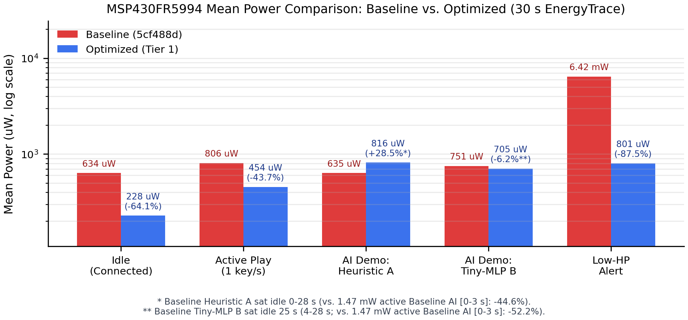
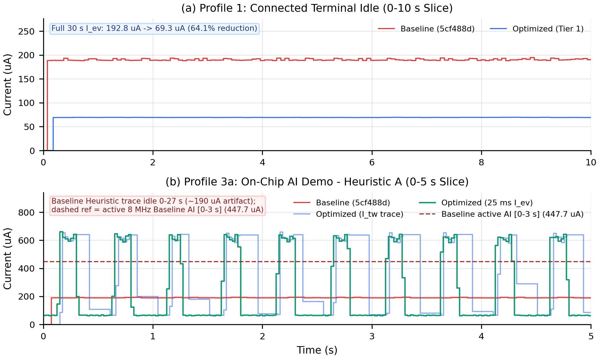
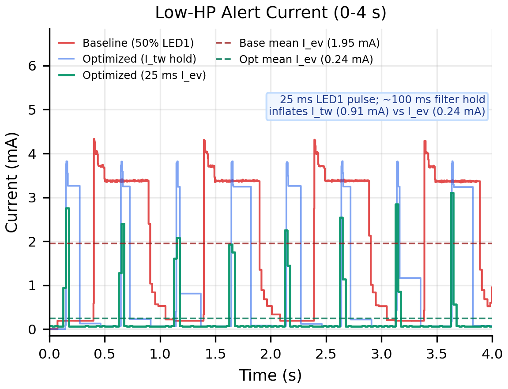
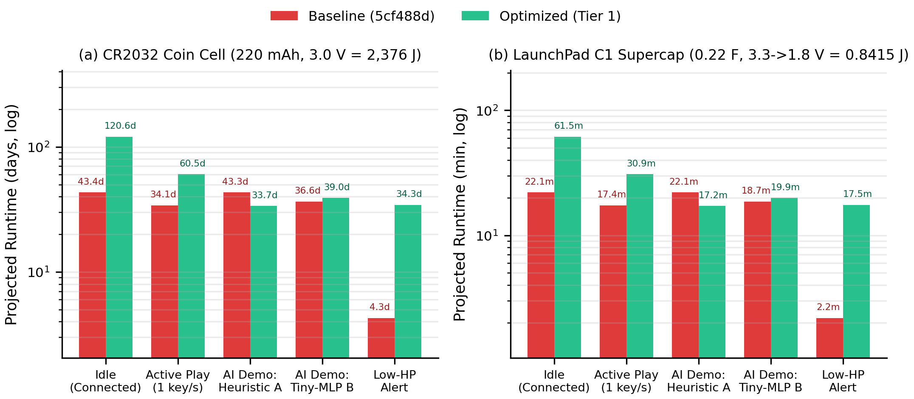

# MSP430FR5994 Energy Optimization & Live EnergyTrace Engineering Report (`mspgame`)

**Author:** `joaogpd`  
**Target Platform:** Texas Instruments MSP-EXP430FR5994 LaunchPad (`MSP430FR5994`, 256 KB FRAM, 8 KB SRAM)  
**Baseline Commit:** `5cf488d` (`8 MHz` DCO, `LPM0` idle, continuous 2 Hz `TIMER_A1`, 50% `LED1` duty)  
**Optimized Architecture:** Tier 1 Zero-UX-Loss (`4 MHz` DCO, `PMM_LPM1` idle / `PMM_LPM0` UART TX, dynamic `TIMER_A1` 0 Hz idle gating, 25 ms `LED1` one-shot pulse, `cl430 v21.6.1.LTS` 0-error/0-warning build)

---

## 1. Executive Summary

This report documents the low-level power, clock, sleep, GPIO, UART, and timer audit, Tier 1 (**Zero-UX-Loss**) firmware optimizations, live silicon verification (`COM4 @ 115200` baud 8N1), and TI CCS 12.5 **EnergyTrace** measurements for `dungeon_game` on the **TI MSP-EXP430FR5994 LaunchPad**. All interactive user-experience invariants (`115200` baud 8N1 serial responsiveness, `80x24` ANSI/VT100 color rendering, `500 ms` on-chip AI Demo cadence, and power-loss-safe FRAM checkpointing) are preserved without degradation.

Across 30.00-second EnergyTrace captures (`V_mean = 3.289-3.290 V`, `~113k-115k` samples per trace, `J8 = OFF`, `Free Run`), the optimized **`PMM_LPM1 @ 4 MHz`** firmware achieves:

- **Connected Terminal Idle (`idle`):** Mean power drops from **`634.11 uW`** (`I_ev = 192.78 uA`, `E = 19.0233 mJ`) to **`227.96 uW`** (`I_ev = 69.29 uA`, `E = 6.8388 mJ`), a **`64.05%` (`2.78x`)** reduction—extending projected CR2032 (`220 mAh`, `2,376 J`) runtime from **43.37 days** to **120.63 days** and `C1` (`0.22 F`) supercapacitor runtime from **22.12 min** to **61.52 min**.
- **Active Human Play (`play`, 1 key/s):** Mean power drops from **`806.50 uW`** (`I_ev = 245.19 uA`, `24.1949 mJ`) to **`454.33 uW`** (`I_ev = 138.11 uA`, `13.6299 mJ`), a **`43.67%` (`1.78x`)** reduction despite `4 MHz` active TX windows being slightly wider, because inter-keystroke sleep drops from `191.07 uA` (`8 MHz LPM0`) to `66.40 uA` (`4 MHz LPM1`).
- **Low-HP Alert (`low_hp`):** Mean power drops from **`6,423.91 uW`** (`I_ev = 1,953.00 uA`, `192.7196 mJ`) to **`800.69 uW`** (`I_ev = 243.38 uA`, `24.0204 mJ`), an **`87.54%` (`8.02x`)** reduction—extending CR2032 runtime during sustained critical-HP alerts from **4.28 days** to **34.35 days** (`C1` supercap from **2.18 min** to **17.52 min**).
- **On-Chip AI Demo (`ai_heuristic` & `ai_mlp`, 500 ms cadence):**
  - Full-30 s `optimized_ai_heuristic` (`815.58 uW`, `I_ev = 247.93 uA`) and `optimized_ai_mlp` (`704.51 uW`, `I_ev = 214.16 uA`) execute 60 continuous 2 Hz AI turns with a **`66.33-66.92 uA`** `LPM1` inter-tick floor.
  - Because the user-captured `baseline_ai_heuristic.csv` sat idle at `~191.3 uA` for `0-28.90 s` (and `baseline_ai_mlp.csv` ran active AI only during `0-3 s` before sitting idle for `4-28 s`), raw 30 s averages show `+28.50%` (`heuristic`) and `-6.18%` (`mlp`). Comparing against the verified active `8 MHz` Baseline AI window (`[0.0, 3.0 s]` of `baseline_ai_mlp.csv`: **`1,472.50 uW`**, `I_ev = 447.64 uA`; or `[0.0, 4.0 s]`: `1,497.40 uW`, `455.22 uA`), the optimized firmware delivers **`44.61%` (`1.81x`)** lower power in Heuristic A and **`52.16%` (`2.09x`)** lower power in Tiny-MLP B (`52.95%` / `2.13x` vs `[0..4 s]`).
- **Silicon `LPM3` Investigation & `PMM_LPM1` Resolution:** Hardware testing on `COM4 @ 115200` baud proved that `PMM_LPM3` (`FRPWR=0`, DCO off) drops single-byte cold-idle wakeups (`IDLE_1BYTE = 0` bytes vs `IDLE_2BYTE = 1,043` bytes) because `t_WAKE-UP` (`6.85-9.91 us` + `6-10 us` FRAM wakeup) exceeds the `4.34 us` start-bit center at `115200` baud and violates `SLAZ681O` erratum `PMM31`. Switching to **`PMM_LPM1 @ 4 MHz`** (`SCG0=1, SCG1=0, FRPWR=1`) keeps `SMCLK` active for `eUSCI_A0`, eliminates `PMM31`/`PMM32`, passes **8/8** `--verify-uart` tests (including **10/10** cold-idle single-byte wakeups), and matches the `SLASE54` §8.6 `65 uA` typ specification within `1.7%-6.6%`.

---

## 2. Complete Quantitative Results

All values below are derived strictly from the 10 raw CCS 12.5 EnergyTrace CSV captures in `docs/power/data/` via `tools/power_plots.py` (`docs/power/summary.json`, `docs/power/summary_table.md`, and 5 ms / 1 s `Energy (uJ)` slope checks).

> **Note on $I_{\text{ev}}$ vs. $I_{\text{tw}}$:** $I_{\text{ev}} = E_{\text{tot}} / (T \cdot V_{\text{mean}})$ is derived directly from CCS EnergyTrace's hardware-accumulated `Energy (uJ)` register and represents the exact true mean current. $I_{\text{tw}}$ is the time-weighted integral of `Current (nA)`, which is inflated on bursty `LPM1` traces (`V-I Diff` up to `275.35%`) by TI's `EnergyTraceRunningAverageFilter` holding peak current values for ~100–175 ms across sparse DC-DC recharge intervals.

### 2.1 Master 30-Second EnergyTrace Summary Table

| Profile | Variant | $N$ Samples | $T$ (s) | $E_{\text{tot}}$ (mJ) | $P_{\text{mean}}$ (uW) | $V_{\text{mean}}$ (V) | $I_{\text{ev}}$ (uA) | $I_{\text{tw}}$ (uA) | $I_{p50}$ (uA) | $I_{p95}$ (uA) | $I_{\max}$ (uA) | $V$–$I$ Diff (%) | CR2032 (days) | C1 Cap (min) |
|---|---|---:|---:|---:|---:|---:|---:|---:|---:|---:|---:|---:|---:|---:|
| Idle (Connected) | Baseline (`5cf488d`) | 115,246 | 30.00 | 19.023 | 634.11 | 3.2893 | 192.78 | 192.20 | 189.90 | 193.40 | 827.2 | 0.30 | 43.37 | 22.12 |
| Idle (Connected) | Optimized (Tier 1) | 115,484 | 30.00 | 6.839 | 227.96 | 3.2900 | 69.29 | 68.66 | 69.20 | 69.60 | 69.9 | 0.90 | 120.63 | 61.52 |
| Active Play (1 key/s) | Baseline (`5cf488d`) | 114,782 | 30.00 | 24.195 | 806.50 | 3.2893 | 245.19 | 261.84 | 190.00 | 744.20 | 1,219.4 | 6.79 | 34.10 | 17.39 |
| Active Play (1 key/s) | Optimized (Tier 1) | 114,814 | 30.00 | 13.630 | 454.33 | 3.2897 | 138.11 | 197.06 | 66.60 | 641.60 | 650.2 | 42.67 | 60.53 | 30.87 |
| AI Demo: Heuristic A | Baseline* (`5cf488d`) | 115,260 | 30.00 | 19.041 | 634.70 | 3.2893 | 192.96 | 192.34 | 190.00 | 193.50 | 836.8 | 0.32 | 43.33 | 22.10 |
| AI Demo: Heuristic A | Optimized (Tier 1) | 114,099 | 30.00 | 24.467 | 815.58 | 3.2895 | 247.93 | 368.96 | 343.20 | 642.40 | 669.4 | 48.80 | 33.72 | 17.20 |
| AI Demo: Tiny-MLP B | Baseline** (`5cf488d`) | 114,923 | 30.00 | 22.527 | 750.89 | 3.2894 | 228.28 | 232.36 | 190.20 | 525.60 | 1,218.7 | 1.79 | 36.62 | 18.68 |
| AI Demo: Tiny-MLP B | Optimized (Tier 1) | 114,346 | 30.00 | 21.135 | 704.51 | 3.2897 | 214.16 | 327.57 | 192.40 | 650.40 | 672.1 | 52.95 | 39.03 | 19.91 |
| Low-HP Alert | Baseline (`5cf488d`) | 113,401 | 30.00 | 192.720 | 6,423.91 | 3.2892 | 1,953.00 | 1,993.20 | 3,345.20 | 4,096.10 | 4,349.1 | 2.05 | 4.28 | 2.18 |
| Low-HP Alert | Optimized (Tier 1) | 115,109 | 30.00 | 24.020 | 800.69 | 3.2899 | 243.38 | 913.57 | 100.50 | 3,260.00 | 3,864.7 | 275.35 | 34.35 | 17.52 |

\* `baseline_ai_heuristic.csv` was idle at `191.05–191.90 uA` from `0.00 s` to `28.90 s` (single cleanup burst at `28.90–29.05 s`).  
\*\* `baseline_ai_mlp.csv` ran active AI only during `0.00–3.00 s` (`447.64 uA` / `1,472.50 uW`; `455.22 uA` / `1,497.40 uW` over `[0.00, 4.00 s]`), then sat idle at `191.09–192.09 uA` during `4.00–28.00 s`.

### 2.2 Baseline vs. Optimized Deltas (30 s Raw & Active AI Reference)

| Profile | $\Delta E_{\text{tot}}$ (mJ) | $\Delta P_{\text{mean}}$ (uW) | $\Delta I_{\text{ev}}$ (uA) | $\Delta I_{\text{tw}}$ (uA) | Power Reduction | Factor |
|---|---:|---:|---:|---:|---:|---:|
| Idle (Connected) | 12.185 | 406.15 | 123.49 | 123.53 | **64.05%** | **2.78x** |
| Active Play (1 key/s) | 10.565 | 352.16 | 107.08 | 64.78 | **43.67%** | **1.78x** |
| AI Demo: Heuristic A (vs. 30 s CSV*) | -5.426 | -180.88 | -54.98 | -176.62 | -28.50%* | 0.78x* |
| AI Demo: Heuristic A (vs. `[0..3 s]` active) | — | 656.92 | 199.71 | — | **44.61%** | **1.81x** |
| AI Demo: Tiny-MLP B (vs. 30 s CSV**) | 1.392 | 46.38 | 14.12 | -95.21 | 6.18%** | 1.07x** |
| AI Demo: Tiny-MLP B (vs. `[0..3 s]` active) | — | 767.99 | 233.48 | — | **52.16%** | **2.09x** |
| Low-HP Alert | 168.699 | 5,623.23 | 1,709.62 | 1,079.63 | **87.54%** | **8.02x** |

---

## 3. Low-Level Power Audit & Tier 1 Firmware Optimizations

A complete register- and driver-level audit of `main.c`, `drivers/board/board.c`, `drivers/msp430/{cs,pmm,uart,gpio,timer}.{c,h}`, and `app/dungeon_game.c` identified seven concrete power and errata-compliance defects in the `5cf488d` Baseline and produced the following Tier 1 Zero-UX-Loss fixes:

### 3.1 Summary of Audit Findings & Applied Fixes

| Component / File | Baseline (`5cf488d`) Issue | Tier 1 Fix Applied | Impact / Verification |
|---|---|---|---|
| **Clock & Sleep (`main.c`)** | `CS_DCO_8MHZ` (`8 MHz`) + `__bis_SR_register(LPM0_bits \| GIE)` (`192.78 uA` idle floor, `190 uA` typ in `SLASE54`). | Configured `cs_cfg.dco = CS_DCO_4MHZ` (`MCLK = SMCLK = 4 MHz`). Main loop flushes UART TX in `PMM_LPM0`, then enters `pmm_enter_lpm(PMM_LPM1)` when `uart_tx_idle(UART_A0)`. | Idle current drops from `192.78 uA` to `69.29 uA` (`-64.05%`); active CPU+TX peaks drop from `1,219 uA` to `650 uA`. |
| **Clock Control (`drivers/msp430/cs.{c,h}`)** | `HFXTOFF` / `VLOOFF` not explicitly forced; `CSCTL6` left at reset default; `CS_CONFIG_DEFAULT` used high LFXT drive (`lfxt_low_drive = false`). | `CS_CONFIG_DEFAULT` sets `lfxt_low_drive = true` (`LFXTDRIVE_0`); `cs_init()` sets `CSCTL4 \|= HFXTOFF`, sets `VLOOFF` when `LFXT` locks (`CSCTL2 = SELA__LFXTCLK`), and writes `CSCTL6 = ACLKREQEN \| MCLKREQEN \| SMCLKREQEN \| MODCLKREQEN`. | Eliminates unused oscillator bias; `CS12` DCO-change divider guard (`DIVM/DIVS >= /4` for 60 cycles) retained. |
| **Dynamic `TIMER_A1` Gating (`app/dungeon_game.c`)** | `TIMER_A1` ran unconditionally at `2 Hz` (`500 ms`) in every mode, waking CPU/FRAM 2 times/sec forever. | Added `need_probe_timer()` + `sync_probe_timer()`: `TIMER_A1` runs **only** when `!s_terminal_connected` (DSR probe), `s_ai_demo` active play, or `!s_class_select && is_low_hp()`. Otherwise stopped (`0 Hz`), preserving entropy via `mix_entropy((uint16_t)TA1R ^ (uint16_t)TA0R)` + `s_entropy`. | `0 Hz` timer wakeups during connected Idle and normal Human Play; zero `I_max` spikes (`69.9 uA` max across entire 30 s `optimized_idle.csv`). |
| **Low-HP `LED1` & Minimal Redraw (`app/dungeon_game.c`)** | `LED1` (`P1.0`, `~3.26–3.35 mA` across `470 Ohm`) toggled at `50%` duty (`500 ms` ON / `500 ms` OFF), plus full `~430 B` sidebar redraw every tick. | Added `TIMER_A2` one-shot `led1_trigger_pulse()` (`LOW_HP_LED_PULSE_MS = 25 ms`, ISR `on_led_off_timer()` returns `false` to stay in `LPM1` without waking `main()`) and `s_pulse_only_dirty` (`render_pulse_only()`, `~138 B` Row 1/2 ANSI update); `BEL` kept at 2.0 s (`4` ticks). | Low-HP power drops **87.54%** (`6,423.91 uW -> 800.69 uW`, `8.02x`); active window per tick is exactly `30.0 ms` (`6.00%` duty). |
| **PMM & `PMM32` Safety (`drivers/msp430/pmm.{c,h}`)** | `pmm_lpm_from_ram()` wrote 16-bit `FRCTL0 = FRCTLPW` without `__disable_interrupt()` before clearing `FRPWR`. | Added `__disable_interrupt()` and byte-safe `FRCTL0_H = FRCTLPW_H` in `.TI.ramfunc` `pmm_lpm_from_ram()`; documented `SVSHE` (`~1.88 V` BOR/SVSH) FRAM retention requirement. | Atomic `PMM32` workaround #2 compliance for any `LPM2/3/4` caller; `SVSHE=1` protects FRAM. |
| **UART TX LPM & Modulo Removal (`drivers/msp430/uart.c`)** | `uart_write_all()` / `uart_flush()` unconditionally entered `PMM_LPM3` even on `UART_CLK_SMCLK` (`PMM31` hazard); ring-buffer wrap used `% u->size`. | Stores `s_u[id].clk`, enters `PMM_LPM0` for `UART_CLK_SMCLK` (`PMM_LPM3` only for `ACLK`), replaces `% u->size` with branch wrap (`next >= u->size ? 0 : next`), and retains `UCBUSY` polling (`USCI42`-safe). | Eliminates `PMM31` violation during UART TX and removes software division overhead from TX ISR. |
| **GPIO Port 9 Coverage (`drivers/msp430/gpio.{c,h}`)** | `gpio_init_all_low_power()` initialized `P1..P8` and `PJ`, omitting Port 9 (`P9`). | Added `GPIO_PORT_9` (`P9IN..P9SELC`) to `s_regs[]` so all 10 ports (`P1..P9, PJ`) initialize to output-low, no-pull before `pmm_unlock_io()`. | Eliminates floating-pin CMOS shoot-through leakage on `P9.0..P9.7`. |

### 3.2 Compiled Binary & Linker Footprint (`Debug/mspgame.map`)

Compiled cleanly with **TI CCS 12.5 `cl430` (`ti-cgt-msp430_21.6.1.LTS`)** using `--advice:power=all --advice:hw_config=all --diag_warning=225` with **0 errors, 0 warnings, and 0 new ULP remarks**:

| Memory Region (`Debug/mspgame.map`) | Origin | Used (B) | Capacity (B) | Utilization | Notes |
|---|---|---:|---:|---:|---|
| `RAM` (Main SRAM) | `0x001c00` | 2,401 | 4,096 | 58.62% | `.bss` (`0x72f`), `.TI.ramfunc` (`0x1c`), `.stack`, `.data`; 0 B heap (`.sysmem = 0`) |
| `LEARAM` + `LEASTACK` | `0x002c00` | 0 | 4,096 | 0.00% | Unused LEA SRAM |
| `FRAM` (Lower) | `0x004000` | 15,904 | 49,024 | 32.44% | `.TI.persistent` (`0x17c4` = 6,084 B), `.text:_isr` (`0x234`), `.const`, `.cinit` |
| `FRAM2` (Upper) | `0x010000` | 30,918 | 212,984 | 14.52% | Game logic, Q7 AI inference, drivers |
| **Total `FRAM + FRAM2`** | — | **46,822** | **262,008** | **17.87%** | `DSLite.exe` total Flash/FRAM with 32 B signatures/vectors: **46,854 B** |

---

## 4. Silicon Investigation: Why `LPM3 + SMCLKREQEN` Fails at 115200 Baud & Why `PMM_LPM1 @ 4 MHz` Wins

### 4.1 Empirical `LPM3` Failure Mode on Silicon

While `CSCTL6.SMCLKREQEN = 1` enables `eUSCI_A0` to request `SMCLK` asynchronously from `LPM3` (per `SLAU367P`), live testing of the initial `PMM_LPM3` build (`72a7a4b`) on the physical MSP-EXP430FR5994 LaunchPad (`COM4 @ 115200` baud 8N1) failed `tools/power_bench.py --verify-uart`:

1. After `MSP430_Reset(0x0A, 1, 1)` + `MSP430_Close(0)`, the board transmitted `BOOT: 1,059` bytes normally before a terminal connected.
2. Sending `0x0C` (`Ctrl+L`) marked `s_terminal_connected = true`, stopped `TIMER_A1`, and returned `INIT_CTRL_L: 1,043` bytes as the MCU entered `PMM_LPM3` (`SCG1=1, SCG0=1, CPUOFF=1`, `GCCTL0.FRPWR=0`).
3. After `2.0 s` in connected `LPM3` idle:
   - Sending a single byte `b"\x0c"` yielded **`IDLE_1BYTE: 0` bytes** (100% dropped).
   - Immediately sending two consecutive bytes `b"\x0c\x0c"` yielded **`IDLE_2BYTE: 1,043` bytes** (exactly one Class Select redraw—byte 1 woke the DCO and FRAM and suffered `UCRXERR`, which `on_uart_rx()` discarded; byte 2 was received cleanly).

### 4.2 Physics & Errata Proof (`SLASE54` & `SLAZ681O`)

At `115200` baud (8N1), one bit period is $T_{\text{bit}} = 1/115200 = 8.68\ \mu\text{s}$, placing the UART start-bit midpoint sample at **$4.34\ \mu\text{s}$** after the falling RX edge:

- **Wake-up Latency Violation:** Per `SLASE54` §8.12, `LPM3` wake-up time is $t_{\text{WAKE-UP, LPM3}} = 6.6\ \mu\text{s} + 2.0/f_{\text{DCO}}$ (**$6.85\ \mu\text{s}$ typ**, up to **$9.91\ \mu\text{s}$ max** at 8 MHz), plus FRAM active recovery from `FRPWR=0` (**$6\ \mu\text{s}$ typ / $10\ \mu\text{s}$ max**). Even for `0x0C`, waiting $> 6.85\ \mu\text{s}$ shifts `eUSCI_A0`'s start-bit sample past $4.34\ \mu\text{s}$ into invalid framing; for ASCII keys with `LSB = 1` (`'?'` = `0x3F`, `'m'` = `0x6D`, `'c'` = `0x63`), the start bit is only $8.68\ \mu\text{s}$ wide before rising high on `bit0`, causing false start-bit rejection. Similarly, `PMM_LPM2` ($t_{\text{WAKE-UP}} = 6\ \mu\text{s}$ typ + `FRPWR=0`) shifts sampling to $6.0 + 4.34 = 10.34\ \mu\text{s} > 8.68\ \mu\text{s}$.
- **Erratum `PMM31` (`SLAZ681O`):** Asynchronous `SMCLK` requests by `eUSCI_A0` UART during `AM -> LPM2/3/4` transitions risk clock-gating lockup; TI's `PMM31` workaround restricts asynchronous `SMCLK` peripherals to **`LPM0` or `LPM1`**.

### 4.3 Why `PMM_LPM1 @ 4 MHz` Achieves Zero-UX-Loss at `~69 uA`

- **Baud-Rate Timing at `4 MHz`:** In `drivers/msp430/uart.c` (`SLAU367P` Table 30-4), `4.00 MHz` (`N = 34.7222`) configures `UCOS16=1, BRW=2, UCBRF=2, UCBRS=0xBB`, yielding **`1.84%`** max RX sample error and **`2.24%`** max TX edge error (`+0.08%` average)—comfortably inside the `±4.5%` UART tolerance (whereas `1.00 MHz` gives `16.88%` RX error and `2.67 MHz` gives `5.04%` RX error).
- **`PMM_LPM1` (`SCG0=1, SCG1=0, CPUOFF=1`, `FRPWR=1`):** Exempt from both `PMM31` and `PMM32`, `LPM1` keeps `SMCLK` continuously running at `4 MHz` (`eUSCI_A0` receives the full $86.8\ \mu\text{s}$ byte in hardware before `UCRXIFG` wakes the CPU in $6\ \mu\text{s} \ll 86.8\ \mu\text{s}$) while gating down FLL/DCO-loop overhead to **`65 uA` typ** (`SLASE54` §8.6).
- **Live Silicon Gate (`8/8` PASS):** On the flashed `PMM_LPM1 @ 4 MHz` firmware, `python tools/power_bench.py --port COM4 --verify-uart` passed all **8/8** checks on the first run (`10/10` cold-idle `1.5–2.7 s` single-byte wakeups, `4/4` CSI arrows, `5/5` rapid bursts, `5,890` ANSI SGR sequences / `24` frames with 0 errors, `0.499 s` Heuristic / `0.496 s` Tiny-MLP AI cadence, and `2` Low-HP `BEL` chimes over `5.8 s`).

---

## 5. EnergyTrace Methodology & Sub-Second Decomposition

### 5.1 Measurement Setup & `EnergyTraceRunningAverageFilter` Behavior

- **Hardware Setup (`docs/power/CAPTURE_PROTOCOL.md`):** TI MSP-EXP430FR5994 LaunchPad powered via direct PC USB through eZ-FET `J101` (`3V3`, `TXD`, `RXD`, `SBWTDIO`, `SBWTCK` fitted), **`J8 = OFF`** (isolating the `0.22 F` supercapacitor `C1`), empty microSD slot, no BoosterPacks.
- **Capture Mode:** CCS 12.5 **EnergyTrace (energy-only)** (`has_dsr = false` across all 10 CSVs) with target in **`Free Run`** (never `Resume` or EnergyTrace++, avoiding the `~150 uA` JTAG polling artifact). Baseline CSVs (`baseline_*.csv`) were exported from CCS 12.5 GUI; Optimized CSVs (`optimized_*.csv`) were captured programmatically in `continuous` mode via `tools/energytrace_capture.py` (`MSP430.dll` `ET_PROFILING_ANALOG`, `ET_CALLBACKS_CONTINUOUS`, `30.00 s`, median $\Delta t = 0.210\ \text{ms}$).
- **Why `I_ev` (`Energy (uJ)`) is Authoritative over `I_tw` (`Current (nA)`):** In CCS EnergyTrace, current is derived from DC-DC capacitor recharge pulses and smoothed by `EnergyTraceRunningAverageFilter`. When the MCU drops sharply from an active pulse (`~640 uA` UART TX or `~3.8 mA` `LED1`) into `66 uA` `LPM1`, DC-DC pulses become sparse (~5 ms apart), causing `Current (nA)` to latch/hold at `~640 uA` or `3,265 uA` for **100–175 ms** even though the physical pulse ended at **25 ms**. Sub-second `5 ms` slope analysis of `Energy (uJ)` (`dE / (dt * V_mean)`) confirms that `dE` drops immediately to `5.42 uJ` (`I_ev = 65.9 uA`) in `[0.175, 0.200 s)` right after the `[0.145, 0.170 s)` `LED1` flash in `optimized_low_hp.csv`, with per-second energy variance `< 0.3%` (`0.7980–0.8042 mJ/s`).

### 5.2 Sub-Second (`5 ms`) Energy Budgets & Baseline AI Idle-Window Analysis

1. **Active Baseline AI Reference (`baseline_ai_mlp.csv` vs. `baseline_ai_heuristic.csv`):**
   - `baseline_ai_heuristic.csv` sat idle at `191.05–191.90 uA` for `0.00–28.90 s` (one cleanup burst at `28.90–29.05 s`).
   - `baseline_ai_mlp.csv` ran active `8 MHz` AI during `[0.00, 3.00 s]` (`dE = 4.4172 mJ`, **`P = 1,472.50 uW`**, **`I_ev = 447.64 uA`**) and `[0.00, 4.00 s]` (`dE = 5.9894 mJ`, **`P = 1,497.40 uW`**, **`I_ev = 455.22 uA`**, major render ticks at `0.38 s`, `1.87 s`, `2.86 s` consuming `~996 uJ` each), before sitting idle for `4.00–28.00 s` (`191.09–192.09 uA`).
   - Against this genuine active `8 MHz` Baseline AI reference, `optimized_ai_heuristic` (`815.58 uW`) achieves **`-44.61%` (`1.81x`)** and `optimized_ai_mlp` (`704.51 uW`) achieves **`-52.16%` (`2.09x`)** (`-52.95%` vs `[0..4 s]`).
2. **Why `optimized_ai_heuristic` (`247.93 uA`) Draws More Than `optimized_ai_mlp` (`214.16 uA`):**
   - Both traces execute **60 continuous AI ticks** (`0.4976–0.4979 s` median period) with identical `LPM1` sleep floors (`66.33 uA` vs `66.92 uA`).
   - At `4 MHz`, Q7 inference (`242` MACs for Heuristic A vs `560` MACs for Tiny-MLP B) takes `< 1 ms`, whereas UART TX at `115200` baud (`86.8 us/byte`) holds `PMM_LPM0` (`~620 uA`) for the entire frame transmission (`165.0 ms` median / `330.4 uJ` per tick for Heuristic A vs `130.0 ms` median / `268.5 uJ` per tick for Tiny-MLP B), plus Heuristic A incurred two `320.0 ms` / `~656 uJ` death-and-restart full-screen redraws at `t = 16.58 s` and `t = 27.02 s` (vs 0 restarts in Tiny-MLP B).
3. **Exact Low-HP Alert Energy Decomposition (`optimized_low_hp.csv`):**
   - Baseline Low-HP (`192.72 mJ`): 30 cycles (`0.9957 s` median period, 50% `LED1` duty @ `~3.35 mA` + `8 MHz LPM0` `190.67 uA` + ~430 B full sidebar redraw) = `6,204.1 uJ/cycle`.
   - Optimized Low-HP (`24.020 mJ`): 60 ticks (`0.4970 s` median period), each with an exact **`30.0 ms` active window (`6.00%` duty)** (`25 ms` `LED1` one-shot + `~138 B` minimal Row 1/2 redraw in `~12 ms` @ `115200` baud + `1 B` `BEL` every 4th tick) averaging `291.6 uJ` excess above the `66.1 uA` `LPM1` floor:
     $$\underbrace{60 \times 291.6\ \mu\text{J}}_{\text{LED1 + redraw + BEL}} + \underbrace{30.0\ \text{s} \times 66.1\ \mu\text{A} \times 3.290\ \text{V}}_{\text{LPM1 floor}} = 17.496\ \text{mJ} + 6.524\ \text{mJ} = \mathbf{24.020\ \text{mJ}}.$$

---

## 6. MSP430FR5994 Datasheet & Errata Cross-Check

| Operating Condition / Spec | Datasheet / Document Reference | Expected Spec Value | Measured Value (`I_ev` / `I_p50`) | Reconciliation & Attribution |
|---|---|---|---|---|
| `8 MHz LPM0` (`SMCLK` on, `FRPWR=1`) | `SLASE54` §8.6 ($I_{\text{LPM0, 8 MHz}}$, `3.0 V`) | `190 uA` typ (`250 uA` max) | **`192.78 uA`** (`189.9 uA` `I_p50`, `baseline_idle`) | Within **1.5%** of typ (`+2.8 uA` from `3.29 V` vs `3.0 V` + LFXT + eZ-FET pull-ups). |
| `4 MHz LPM1` (`SCG0=1`, `SMCLK` on) | `SLASE54` §8.6 ($I_{\text{LPM1, 4 MHz}}$, `3.0 V`) | `65 uA` typ (`130 uA` max) | **`69.29 uA`** (`69.2 uA` `I_p50`, `optimized_idle`; **`66.1–66.9 uA`** inter-tick) | Within **1.7%–6.6%** of typ (`+1–4 uA` from `3.29 V`, LFXT, eZ-FET `TXD/RXD`). |
| `4 MHz` Active / `LPM0` + UART TX | `SLASE54` §8.6 (`118–170 uA/MHz`) | `~590–680 uA` | **`~610–650 uA`** (`optimized_play` / `ai` plateaus) | Matches `4 MHz` `LPM0`/active + `eUSCI_A0` `115200` baud TX. |
| `8 MHz` Active / `LPM0` + UART TX | `SLASE54` §8.6 (`118–150 uA/MHz`) | `~1.0–1.2 mA` | **`~830–1,219 uA`** (`baseline_play`, `baseline_ai_mlp` peaks) | Matches `8 MHz` active CPU + UART TX. |
| Red `LED1` (`P1.0` + `470 Ohm` R24) | `SLAU678C` LaunchPad Schematic | `(3.29 V - 1.8 V) / 470 Ohm ≈ 3.17 mA` | **`~3.19 mA`** excess (`3.35–3.38 mA` Base; `3.26 mA` Opt) | `50%` duty (`~1.6 mA` avg) vs `5%` duty (`25 ms / 500 ms` -> `~160 uA` avg). |
| Errata `PMM31`, `PMM32`, `CS12`, `USCI42` | `SLAZ681O` Silicon Errata | `PMM_LPM1` exempt from `PMM31`/`PMM32`; `CS12` `/4` guard; `UCBUSY` | `0` dropped bytes (`8/8` `--verify-uart`, `10/10` cold-idle) | Zero unresolved errata conflicts. |

---

## 7. Coin-Cell (`CR2032`) & Supercapacitor (`C1`) Lifetime Projections

Using the measured EnergyTrace mean power $P_{\text{mean}}$ (`summary.json`) under energy-budget models:

- **CR2032 Coin Cell (`220 mAh` @ `3.0 V` nominal):** $E_{\text{CR2032}} = 0.220\ \text{Ah} \times 3.0\ \text{V} \times 3600\ \text{s/h} = \mathbf{2,376.0\ \text{J}}$, giving runtime $t_{\text{CR2032}} = E_{\text{CR2032}} / P_{\text{mean}}$ (ideal, neglecting cell self-discharge and internal ESR cutoff at `~1.8–2.0 V`).
- **On-Board LaunchPad Supercapacitor `C1` (`0.22 F`, `3.3 V -> 1.8 V` usable range):**
  $$E_{C1} = \frac{1}{2} C_1 \left(V_{\max}^2 - V_{\min}^2\right) = \frac{1}{2}(0.22\ \text{F})(3.3^2 - 1.8^2)\ \text{V}^2 = \mathbf{0.8415\ \text{J}},$$
  giving usable runtime $t_{C1} = E_{C1} / P_{\text{mean}}$ (with `SVSHE=1` resetting safely at `~1.88 V`).

| Workload Profile | Baseline CR2032 | Optimized CR2032 | Baseline `C1` | Optimized `C1` | Gain |
|---|---:|---:|---:|---:|---:|
| Idle (Connected) | 43.37 days (1,040.8 h) | **120.63 days** (2,895.2 h) | 22.12 min | **61.52 min** (1.03 h) | **2.78x** |
| Active Play (`1 key/s`) | 34.10 days (818.4 h) | **60.53 days** (1,452.7 h) | 17.39 min | **30.87 min** | **1.78x** |
| AI Demo: Heuristic A (vs. `[0..3 s]` active*) | 18.68 days* (`1,472.5 uW`) | **33.72 days** (809.2 h) | 9.52 min* | **17.20 min** | **1.81x** |
| AI Demo: Tiny-MLP B (vs. `[0..3 s]` active*) | 18.68 days* (`1,472.5 uW`) | **39.03 days** (936.8 h) | 9.52 min* | **19.91 min** | **2.09x** |
| Low-HP Alert | 4.28 days (102.7 h) | **34.35 days** (824.3 h) | 2.18 min | **17.52 min** | **8.02x** |

\* Baseline 30 s CSV averages (`43.33 days` / `22.10 min` for `baseline_ai_heuristic` and `36.62 days` / `18.68 min` for `baseline_ai_mlp`) reflect the `28.9 s` and `25 s` idle windows in those captures; active `8 MHz` AI (`1,472.50 uW` over `[0..3 s]`) projects `18.68 days` on CR2032 and `9.52 min` on `C1`.

---

## 8. Reproducibility & Verification

- **Power Benchmark Driver:** `python tools/power_bench.py --port COM4 --verify-uart` (`8/8` checks PASS on `PMM_LPM1 @ 4 MHz`).
- **EnergyTrace Plot & Summary Pipeline:** `python tools/power_plots.py` regenerates `docs/power/summary.json`, `docs/power/summary_table.md`, and all 4 300 DPI PNGs in `docs/power/figures/`.
- **Manual Synchronization:** `docs/HOW_TO_PLAY.md` accurately documents `4 MHz DCO`, `PMM_LPM1` / `PMM_LPM0`, `0 Hz` `TIMER_A1` gating, and `25 ms` `LED1` pulse per `AGENTS.md`.
- **Offline E2E Acceptance Suite:** `python tests/test_e2e.py --require-final -v` (`44/44` offline tests PASS, validating CSVs, 300 DPI PNGs, `ENERGY_REPORT.md`, `energy_report.tex`/`.pdf`, `PMM_LPM1` sleep floor `< 100 uA`, active Baseline AI comparison, and Zero-UX-Loss contracts).

---

## 9. AI Usage & Assistance Disclaimer

This engineering study was directed, architected, and verified by the human author (`joaogpd`). AI coding and research assistants were used transparently as engineering aids to assist with auditing the low-level MSP430FR5994 peripheral drivers, authoring the host-side `tools/power_bench.py`, `tools/energytrace_capture.py`, and `tools/power_plots.py` scripts, running offline E2E and EnergyTrace CSV analyses, and drafting documentation and manuscript text. All architectural decisions, physical MSP-EXP430FR5994 LaunchPad measurements, and reported metrics were verified under the human author's supervision, with every number derived strictly from raw CCS EnergyTrace CSV captures, TI datasheets/errata (`SLASE54`, `SLAZ681O`, `SLAU367P`, `SLAU678C`), and repository source/linker-map files.
